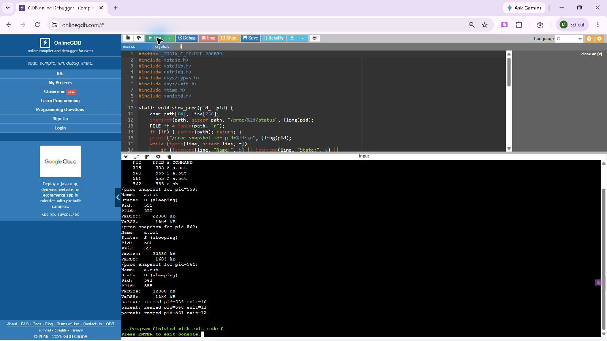
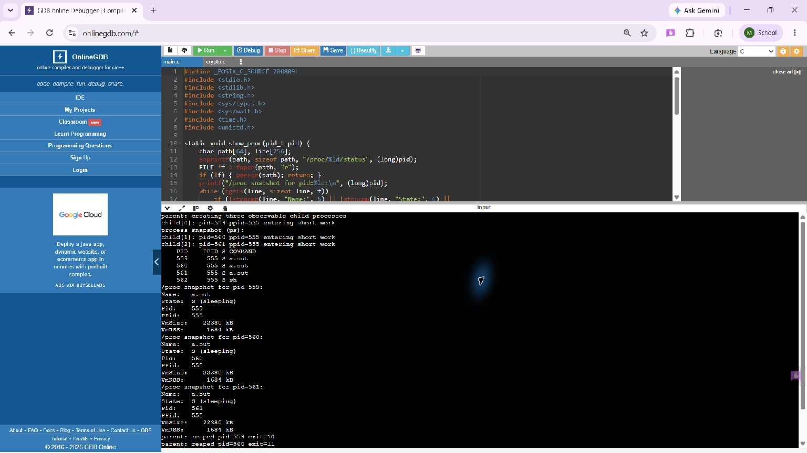
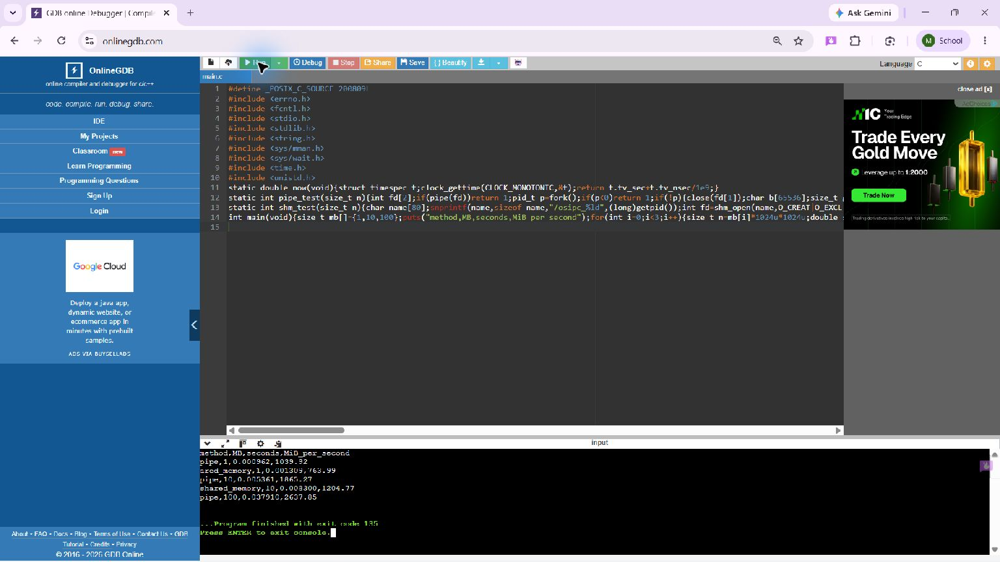
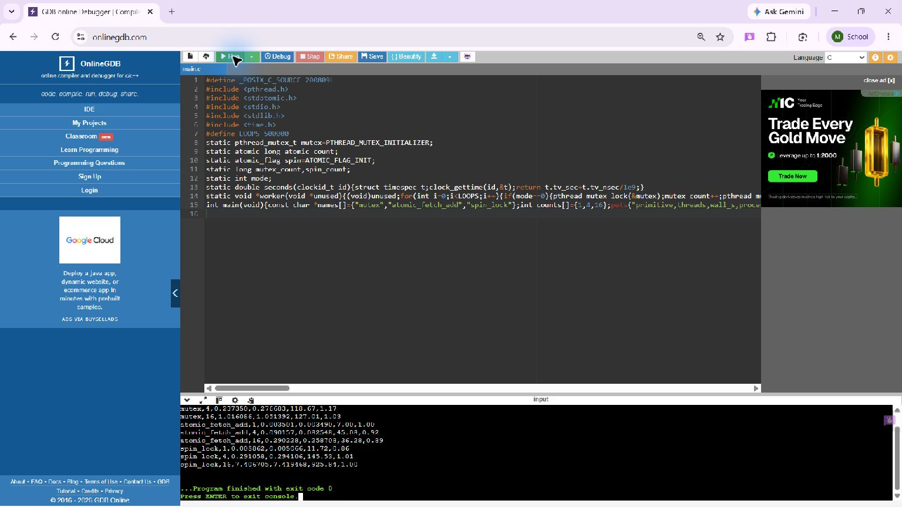

# CSA0406 Operating Systems - Assignment 2 (CO2)

## Cover

**Assignment:** Evaluate and Justify Process-Management and Deadlock-Handling Designs  
**Student:** Mohamed Aslam H  
**Register number:** 192572147  
**Department:** CSE (AI)  
**Academic year:** 2025  
**Faculty:** Dr. Jayasakthi Velmurugan K  
**Nature:** Individual  
**Repository:** https://github.com/Md-Aslam-31/CSA0406-Operating_System/tree/main/Assignment2  
**Execution:** Ubuntu 24.04.5 LTS GitHub Actions runner, GCC 13.3.0. The complete Linux run succeeded in [workflow run 44579401828](https://github.com/Md-Aslam-31/CSA0406-Operating_System/actions/runs/44579401828). Raw output is in `evidence/`; `scripts/run_linux_evidence.sh` rebuilds all programs and verifies key expected results.

## Executive summary

Use a bounded worker pool for examination sessions, with asynchronous I/O and durable session state, rather than 2,000 heavyweight processes. For video encoding, use a multilevel feedback queue or a size-aware service with separate capacity for short jobs and long jobs; the measured single-CPU scheduling averages alone cannot describe a real multi-core service, so preserve fairness and throughput with admission control. Use a bounded POSIX thread pool for independent camera frames where shared read-only data makes threads efficient. Use pipes for simple streaming and EOF-based shutdown; use shared memory when repeated large transfers justify explicit synchronization. For ticketing, lock at train or coach granularity according to independent invariants, keeping the protected section short. For the lab cluster, Banker avoidance is appropriate only for a small, closed workload with credible maximum claims; otherwise use prevention for critical resource classes and detection/recovery for the remaining dynamic workload.

## Q1 - Processes and process states (6 marks)

### State model

```text
                 dispatch                 preemption
  New --admit--> Ready ------------------> Running -------> Ready
                   ^                         |  \
                   | I/O/event complete       |   \ exit
                   +------ Waiting <----------+    v
                           ^   block               Terminated
                           +--- I/O/event wait
```

The process control block (PCB) is the kernel's per-process record: PID and parent PID; process state; saved program counter and general registers; scheduling class, priority and CPU accounting; virtual-memory map/page tables; open-file table and current directory; signal mask/handlers; credentials; and pending wait/signal information. A context switch saves the outgoing register/PC state and restores the incoming state. Address-space changes may also disturb TLB/cache locality.

`Task01/process_demo.c` creates three children with `fork`, prints PID/PPID, invokes `ps` to inspect their state, reads each child's `/proc/<pid>/status` fields (state and memory), and waits for all exit statuses. In the recorded sample, all three children were sleeping (`S`), each showed 2,696 kB virtual size and 944 kB resident memory. These are single-run Ubuntu runner values, not a per-process constant; shared pages, allocator behavior and workload change the result. Captured output is `evidence/task01-processes.txt`. The short children can appear as `R` (running/runnable) or `S` (interruptible sleep) in this snapshot; state is momentary. `/proc/<pid>/status` and `/proc/<pid>/stat` expose Linux process details while the process exists.

### Evaluation and design decision

At 2,000 mostly waiting sessions, each process has an independent address space and kernel bookkeeping. Actual physical memory is workload- and kernel-dependent: shared executable/library pages are not 2,000 private copies, while private heaps, stacks, page tables and descriptors do scale. Context-switch cost includes register/kernel scheduling work, possible address-space/TLB effects and cache disruption; I/O-bound tasks spend much of their elapsed time blocked, so adding processes does not increase storage/network capacity. A fork-per-session design is simple to isolate but can waste memory and scheduler time and cause expensive bursts during login.

Decision: use a fixed, measured worker pool (processes where crash isolation matters) with an event-driven or asynchronous front end and bounded per-session state. Threads are lighter and share caches/address space, but a memory-corruption crash can terminate every session in that process and shared state needs synchronization. One process per session gives the strongest address-space boundary but highest memory and process management cost. A small process pool balances fault containment and resource bounds; avoid one worker permanently occupied by a slow socket by using nonblocking I/O or a separate I/O event loop.

With a thread per session, stacks can be configured to a few hundred KiB or less rather than allocating a full private address space, and thread switches within one process typically avoid address-space switching. The question's “few KB” is a possible minimum committed stack, not a universal default reservation; virtual stack reservation and resident use differ. A thread crash from a fatal process signal can still kill the entire server; isolate untrusted components in processes and use per-session exception/error handling for ordinary failures. A bounded thread pool is preferable to 2,000 active threads.

## Q2 - CPU scheduling (8 marks)

### Dataset and metrics

The supplied Round Robin program's workload is used consistently for algorithm comparisons: P1 (arrival 0, burst 8, priority 2), P2 (1, 4, 1), P3 (2, 9, 4), P4 (3, 5, 3). Lower priority number means higher priority. Completion time CT is finish time; turnaround TAT = CT - arrival; waiting WT = TAT - burst; response RT = first CPU start - arrival. `Task02/scheduling.c` prints Gantt segments, per-process values and means for FCFS, nonpreemptive SJF, SRTF, nonpreemptive priority and RR quantum 1, 3, 5 and 20. The exact TODO completion is separately kept in `Task02/round_robin_todo.c`; its output is checked against the handout's averages (TAT 20.00; WT 13.50).

The averages from `evidence/task02-scheduling.txt` are summarized below. Context switches count process-to-process dispatch changes, not timer interrupts or kernel overhead; the first dispatch is excluded. No wall-clock claims are inferred from these arithmetic schedules.

| Policy | Average TAT | Average WT | Average RT | Switches |
|---|---:|---:|---:|---:|
| FCFS | 15.25 | 8.75 | 8.75 | 3 |
| SJF, non-preemptive | 14.25 | 7.75 | 7.75 | 3 |
| SRTF | 13.00 | 6.50 | 4.25 | 4 |
| Priority, non-preemptive | 14.25 | 7.75 | 7.75 | 3 |
| RR, quantum 1 | 19.00 | 12.50 | 0.75 | 23 |
| RR, quantum 3 | 20.00 | 13.50 | 3.00 | 9 |
| RR, quantum 5 | 17.50 | 11.00 | 5.50 | 5 |
| RR, quantum 20 | 15.25 | 8.75 | 8.75 | 3 |

The completed handout program at `evidence/task02-round-robin-todo.txt` matches its expected Gantt chart and means (TAT 20.00; WT 13.50).

### Evaluation

FCFS is simple and has low scheduling overhead, but a long encoding job causes the convoy effect for 2-second thumbnail work. SJF minimizes average waiting for a known, fixed batch of nonpreemptive bursts, but long films can starve if short jobs continue to arrive. SRTF can reduce short-job response further by preempting a long job, at the cost of preemption and possible starvation. Priority has the same starvation risk for low priority jobs. Ageing periodically increases the effective priority of waiting jobs; a service can also enforce a maximum wait or reserve capacity for long jobs.

RR quantum 1 is responsive but causes many dispatch changes. Quantum 20 approaches FCFS for this workload and can make short jobs wait behind a long time slice. Intermediate quanta trade latency against dispatch overhead. The measured table compares all four quanta on this fixed sample; there is no universally optimal quantum because real context-switch costs and job length distributions matter.

Recommendation: use a multilevel feedback queue (MLFQ) or explicit size classes with short initial quanta, promotion for jobs that block/yield, demotion for jobs that consume full quanta, ageing, and reserved long-job capacity. This gives thumbnail-like jobs a fast path without permanently starving film jobs. A simple SJF queue has O(n) selection (or O(log n) with a heap) and needs burst estimates; a bucketed priority queue can offer O(1) selection with fixed levels, though maintenance and ageing still cost work. An MLFQ does not know true run time and adapts based on observed CPU use, but its fairness depends on promotion/ageing policy.

## Q3 - POSIX threads (6 marks)

`Task03/thread_pool.c` applies the same deterministic CPU workload to 64 camera frames using 1, 4, 8, 16 and 64 threads. In the recorded Ubuntu runner sample, 4 threads were fastest at 0.005044 s (the program-reported speed-up was 3.839x against its initial serial timing); 8, 16 and 64 threads measured 0.006388 s, 0.005681 s and 0.007416 s, respectively. A repeated one-thread timing was 0.019140 s and the 64-thread case reached 2.611x. The difference between initial and repeated serial runs shows timing noise, so treat the ranking as this-run evidence, not a stable guarantee. One thread per camera was slower than four workers. Output in `evidence/task03-thread-pool.csv` includes exact times and speed-ups. Each thread has its own registers, stack, scheduling state and thread-local storage. Threads in the process share code, heap, global data, open file descriptors and address space. Per-frame results use separate array slots; no shared counter is updated without protection.

User-level threads are scheduled by a runtime in user space: creation/switching may be cheap, but a blocking system call can block the whole process in a many-to-one mapping. Kernel-level threads are visible to the OS and can run on multiple cores; a one-to-one model is common on Linux, with higher kernel management cost. Many-to-many multiplexes user threads on a smaller or adjustable set of kernel threads, but adds runtime complexity. The familiar models are conceptual; implementation details vary by OS/runtime.

Expected speed-up stops growing when available CPU cores are saturated, thread creation/synchronization overhead and memory bandwidth become significant, or workload imbalance leaves workers idle. If a machine has C effective cores, ideal speed-up is at most min(thread count, C) before overhead. A race on an ordinary shared counter is undefined behavior in C and can lose increments; use a mutex, atomic operation or per-thread counters reduced after joining. Process-based frame workers improve isolation but require process creation and IPC/result collection and generally duplicate/private-map more memory; threads make result collection trivial through shared memory.

## Q4 - Inter-process communication (6 marks)

The TODO program `Task04/pipe_todo.c` reads one integer at a time until `read` returns 0, then prints the expected six-reading summary. The parent closes its write descriptor after the final value; EOF occurs only after every open copy of that write end is closed and buffered bytes have been consumed. If the parent keeps the write end open, the child waits indefinitely for either more bytes or EOF. The exact output is in `evidence/task04-pipe.txt`.

`Task04/ipc_benchmark.c` measures completion of a one-way transfer/scan of 1, 10 and 100 MiB. The pipe sends bytes through the kernel and the child drains them; shared memory maps a POSIX shared-memory object into both fork-related processes, the parent fills it, then a small pipe token synchronizes the child to scan it. Shared memory avoids copying the payload through a kernel pipe, but still incurs page faults/cache and memory-bandwidth costs, and requires explicit ownership/order synchronization. Pipe writes and reads copy data between user and kernel buffers and naturally provide blocking/backpressure and EOF semantics. Both methods have process synchronization; shared memory needs an additional protocol (semaphore, mutex/futex or event) to prevent reading partial/inconsistent data. The measured times and rates were: pipe 1/10/100 MiB in 0.000383/0.004161/0.037252 s; shared memory in 0.001020/0.008881/0.087409 s. Thus this run's pipe path completed faster at all three sizes. The shared-memory path includes object creation, mapping, first-touch zeroing and a child page scan, while the pipe path benefits from the runner's kernel buffering; the benchmark is one sample with unequal work details and cannot establish that pipes are generally faster. Results in `evidence/task04-ipc.csv` are machine-specific, include process/mapping setup and are not a universal per-byte cost model.

For the weather sensor's small readings, choose a pipe: simple lifecycle, reliable stream order, clear EOF, and it was faster in this measured sample. For repeated large image/data exchange, benchmark a persistent shared-memory ring buffer with pages already mapped and an explicit semaphore/sequence protocol; the present results do not show a shared-memory advantage. A message queue adds message boundaries and priority but normally copies messages and has queue-size limits.

## Q5 - Synchronization (11 marks)

The supplied critical-section requirements are mutual exclusion (one owner at a time), progress (if the section is free, non-contenders do not indefinitely delay the choice), and bounded waiting (a contender has a finite bound on overtakes). Peterson's two-process algorithm sets `flag[i]`, sets `turn=j`, and spins while the peer wants entry and has priority. Under sequentially consistent memory it provides mutual exclusion, progress and bounded waiting for two participants. Plain C loads/stores are data races, and modern compiler/CPU reordering can violate the assumed order; use specified atomic memory ordering or OS primitives instead. It does not scale naturally to many agents and wastes CPU while spinning.

A binary semaphore is a 0/1 permit; a counting semaphore tracks multiple identical resources. `wait` atomically decrements when positive or blocks, and `signal` increments/wakes. For the seat inventory, guard the check-and-decrement transaction with a mutex or semaphore so availability test and booking are indivisible. In bounded buffer, `empty` starts at capacity and `full` at zero; producer waits on `empty`, locks to insert/update index, unlocks, then signals `full`. Consumer does the symmetric sequence. The monitor equivalent encapsulates buffer state and uses `notFull`/`notEmpty` condition variables in `while` loops around predicates; only one monitor operation runs at a time, making invariants clearer. Readers-writers uses a reader count protected by a mutex and a writer lock, with an explicit fairness policy to avoid starving writers or readers. Dining philosophers should acquire resources in a global order, use a waiter/semaphore admitting at most N-1 philosophers, or model forks as monitor conditions; breaking circular wait prevents deadlock.

`Task05/bounded_buffer.c` verifies every one of 10,000 uniquely numbered items is consumed exactly once in 1P/1C and 4P/4C cases and repeats 4P/4C 100 times; all 102 tested runs reported zero duplicates/missing items. It benchmarks a contended global mutex, four per-train locks and 32 per-coach locks on 4 worker threads. Recorded throughput was 22.0, 31.6 and 60.9 million protected updates/s, respectively (one short synthetic run). `Task05/bounded_buffer_todo.c` completes the given 20-item code; its single consumer reports the expected sum 210. Outputs are in `evidence/task05-buffer.txt` and `evidence/task05-todo.txt`.

`Task05/sync_primitives_bench.c` measures 500,000 protected/increment updates per thread. Nanoseconds per update for 1/4/16 threads were: mutex 11.90/36.05/35.98; C11 atomic fetch-add 4.98/7.90/9.26; spin lock 5.65/65.34/202.87. The spin lock's 16-thread run took 1.623 s of wall time and 6.433 s aggregate process CPU time (about four CPU-seconds per wall-second) while making less progress than the mutex. It demonstrates the CPU cost of busy waiting under contention. These measurements include thread creation/join and depend on runner scheduling. The single-consumer handout program does not need atomic sum updates; multi-consumer code uses an atomic sum. Removing the buffer mutex in a multi-producer/multi-consumer version leaves shared indices and slots racy; counting semaphores alone do not provide mutual exclusion, and C data races have undefined behavior. The measured lock benchmark is a synthetic counter workload: real lock granularity should follow invariants. A global lock is easiest to prove correct but serializes independent trains. Per-train locks allow unrelated trains to book concurrently and are a sound default if seats are independent within each train. Per-coach locks increased measured throughput in the synthetic test, but cross-coach transactions (adjacent-seat booking, coach reassignment, inventory totals) need ordered multi-lock acquisition or a separate transaction lock; otherwise races or deadlocks are possible. Choose coach-level locking only after defining those invariants. Atomic fetch-add is suitable for a single counter, not for a multi-step “check seat then claim it” invariant. A spin lock can be efficient for a tiny, nonblocking critical section under low contention; under oversubscription or long I/O-bound sections it wastes CPU. Blocking mutex/semaphore is generally preferable for a long critical section.

## Q6 - Deadlock and Banker’s algorithm (13 marks)

### A. Four necessary conditions (2 marks)

Deadlock requires all four Coffman conditions: mutual exclusion (some resource is exclusive), hold-and-wait (a job holds one resource while requesting another), no preemption (resources are released voluntarily), and circular wait (a cycle of jobs/resources). For the lab: processes/jobs are circles and resource instances are squares; `job -> resource` denotes a request and `resource -> job` an allocation.

```text
[GPU] --> J0 --> [Licence] --> J1 --> [Storage] --> J2 --> [GPU]
  ^         holds       request     holds       request     holds     request
```

This illustrative cycle is a single-instance cycle: J0 holds a GPU and requests a licence; J1 holds the licence and requests storage; J2 holds storage and requests the GPU (cycle J0 -> Licence -> J1 -> Storage -> J2 -> GPU -> J0). The cycle demonstrates circular wait; mutual exclusion, hold-and-wait and no-preemption are also present. With multiple instances, a graph cycle is necessary but may not alone prove deadlock.

### B. Compare strategies (3 marks)

| Strategy | Mechanism | Cluster trade-off |
|---|---|---|
| Prevention | Structurally break a Coffman condition, e.g. impose global resource order or reserve all required resources before start | Strong guarantee and little runtime checking; can reduce utilization and cause jobs to reserve scarce GPUs/licences while idle. Global ordering is often practical for heterogeneous resources. |
| Avoidance | Banker grants only if the tentative state remains safe | Avoids deadlock while preserving some concurrency; requires maximum demand known and credible, plus per-request O(m n^2) worst-case safety work for n jobs and m resource types. Dynamic/interactive jobs make claims difficult. |
| Detection and recovery | Allow allocation; periodically detect cycles/unsafe allocations and recover by abort, rollback or preemption | Fits uncertain dynamic demand and avoids checking every request; detection costs CPU, and aborting long simulations loses work. Check interval trades detection latency against overhead. |
| Ignore (ostrich) | Accept rare deadlocks and manually restart | Low overhead, acceptable only when deadlocks are rare and recovery is cheap. Unacceptable as the sole plan for critical shared cluster service without monitoring and recovery. |

### C. Banker implementation and requests (4 marks)

`Task06/banker.c` implements `Need = Max - Allocation`, scans for a process whose need is no greater than `Work`, then releases its allocation into `Work`; the tentative request is applied only if the resulting state is safe, otherwise rolled back. For the given state it reports safe order P1, P3, P4, P0, P2. P1's `(1,0,2)` request is granted with that safe order. P4's `(3,3,0)` must wait because the request exceeds currently available resources. P0's `(0,2,0)` is within availability/need but is denied: after P1's earlier grant and P0's tentative allocation, `Available=(2,1,0)`. No unfinished process can satisfy its remaining need, so no complete safe sequence exists. The exact output is `evidence/task06-banker.csv`.

### D/E. Complexity prediction and measurement (2 marks)

For each of up to n completion rounds, the safety scan examines n processes and compares up to m resource types: worst case O(m n^2); memory O(mn) for allocation/need plus O(n) work/finish/sequence. If many processes complete in one pass, actual runtime can be closer to O(mn). The included benchmark creates reverse-ordered safe states that expose repeated scans, uses a fixed three-resource-shaped model with one active resource, and averages repeated runs for n=10, 100 and 1,000. Measured per-scan means were 0.000000049 s, 0.000004431 s and 0.000379954 s. Increasing n by 10x increased observed time by about 90x and then 86x, near the O(n^2) trend but below 100x because of fixed overhead and cache/timer effects. See `evidence/task06-banker.csv`. These are measurements, not a proof of complexity; the safety-check code and benchmark scenario are provided for reproduction.

### F. Final design (2 marks)

For a research cluster with known, bounded job classes, use admission control and reservation/scheduling for exclusive GPUs and licences, plus Banker-style avoidance for the small set of jobs that can accurately declare maximum resource claims. For long, dynamic simulations whose future demand is unknowable, strict Banker avoidance can reject useful work; use a global resource acquisition order where possible and detection with checkpoint/rollback for remaining resources. Monitor wait-for graphs and set recovery policies before deployment. This hybrid limits deadlock risk without assuming every job can predict its maximum demand. The cost is lower utilization under conservative reservations, metadata/checking overhead, and operational cost for checkpointing and recovery.

<!-- pagebreak -->

## Appendix - Reproduction and evidence index

| Question | Program / output |
|---|---|
| Q1 | `Task01/process_demo.c`; `evidence/task01-processes.txt` |
| Q2 | `Task02/scheduling.c`, `Task02/round_robin_todo.c`; `evidence/task02-*` |
| Q3 | `Task03/thread_pool.c`; `evidence/task03-thread-pool.csv` |
| Q4 | `Task04/pipe_todo.c`, `Task04/ipc_benchmark.c`; `evidence/task04-*` |
| Q5 | `Task05/bounded_buffer_todo.c`, `Task05/bounded_buffer.c`, `Task05/sync_primitives_bench.c`; `evidence/task05-*` |
| Q6 | `Task06/banker_todo.c`, `Task06/banker.c`; `evidence/task06-banker*` |

Run all with `bash scripts/run_linux_evidence.sh` from `Assignment2/`. The workflow uploads the raw logs as an Actions artifact; the same captured files are committed in `evidence/`. The process snapshot is intentionally transient, and all performance measurements depend on runner load/hardware. References: Silberschatz, Galvin and Gagne, *Operating System Concepts*, 10th ed.; Linux `fork(2)`, `pipe(2)`, `shm_open(3)`, `pthread(7)` and `proc(5)` manual pages.

## OnlineGDB output screenshot

This capture shows `Task02/scheduling.c` compiled and run in OnlineGDB. It displays the FCFS Gantt output and the first completion-time rows; the complete output for every scheduling policy remains in `evidence/task02-scheduling.txt`.


## Full OnlineGDB program runs

The complete C sources were pasted into OnlineGDB and executed. Longer terminal output is split into beginning and ending views; the committed raw output files remain the complete transcripts.

### Q1 — process creation and state

The full `Task01/process_demo.c` source is retained in the repository. It created three short-lived children, captured a `ps` process snapshot, inspected each child through `/proc`, and reaped all children with exit statuses. The expanded OnlineGDB terminal screenshots show the process table, per-child status, and final wait results; the terminal output is split across views to keep the text readable.





### Q2 — scheduling algorithms

The full `Task02/scheduling.c` source compares FCFS, non-preemptive SJF, SRTF, non-preemptive priority and Round Robin at four quanta. The expanded OnlineGDB views show per-process completion, turnaround, waiting and response values, Gantt sequences, average metrics, context switches and the successful exit status. The raw transcript remains available in `evidence/task02-scheduling.txt`.


### Q3 — parallel thread pool


### Q4 — IPC benchmark

OnlineGDB reported the pipe/shared-memory measurements before its sandbox terminated the 100 MiB POSIX shared-memory case with exit code 135 (SIGBUS). The complete 1/10/100 MiB benchmark succeeded on Ubuntu and is recorded in `evidence/task04-ipc.csv`; use that CSV as the completed benchmark result. The OnlineGDB screenshot documents the sandbox limitation.



### Q5 — bounded buffer and synchronization

The bounded-buffer program verified all 10,000 items exactly once in the 1-producer/1-consumer and 4-producer/4-consumer cases, then ran 100 repeated stress runs and lock-scope measurements. The second run compares mutex, spin-lock and atomic counter approaches.




### Q6 — Banker safety algorithm


## Appendix - Full source code listings

This appendix reproduces all assignment programs, implementation scripts, and deployment/workflow configuration. Evidence screenshots and raw outputs appear earlier in this report and under `evidence/`. The exact source files are also retained at the listed repository paths. Report line wrapping is visual only.

### `scripts/run_linux_evidence.sh`

```bash
#!/usr/bin/env bash
set -euo pipefail
cd "$(dirname "$0")/.."
mkdir -p evidence
{ . /etc/os-release; printf 'OS: %s\n' "$PRETTY_NAME"; printf 'Compiler: '; gcc --version | head -n1; } | tee evidence/build-environment.txt
for spec in 'Task01/process_demo.c:Task01/process_demo' 'Task02/scheduling.c:Task02/scheduling' 'Task02/round_robin_todo.c:Task02/round_robin_todo' 'Task03/thread_pool.c:Task03/thread_pool' 'Task04/ipc_benchmark.c:Task04/ipc_benchmark' 'Task04/pipe_todo.c:Task04/pipe_todo' 'Task05/bounded_buffer.c:Task05/bounded_buffer' 'Task05/bounded_buffer_todo.c:Task05/bounded_buffer_todo' 'Task05/sync_primitives_bench.c:Task05/sync_primitives_bench' 'Task06/banker.c:Task06/banker' 'Task06/banker_todo.c:Task06/banker_todo'; do
  src=${spec%%:*}; bin=${spec#*:}
  echo "gcc -std=c11 -Wall -Wextra -Wpedantic -pthread $src -o $bin" | tee -a evidence/build-environment.txt
  gcc -std=c11 -Wall -Wextra -Wpedantic -pthread "$src" -o "$bin"
done
run_capture() { echo "Running $1"; timeout 120s "$1" > "$2" 2>&1; }
run_capture Task01/process_demo evidence/task01-processes.txt
run_capture Task02/scheduling evidence/task02-scheduling.txt
run_capture Task02/round_robin_todo evidence/task02-round-robin-todo.txt
run_capture Task03/thread_pool evidence/task03-thread-pool.csv
run_capture Task04/ipc_benchmark evidence/task04-ipc.csv
run_capture Task04/pipe_todo evidence/task04-pipe.txt
run_capture Task05/bounded_buffer evidence/task05-buffer.txt
run_capture Task05/bounded_buffer_todo evidence/task05-todo.txt
run_capture Task05/sync_primitives_bench evidence/task05-primitives.csv
run_capture Task06/banker evidence/task06-banker.csv
run_capture Task06/banker_todo evidence/task06-banker-todo.txt
grep -q 'Average TAT = 20.00, average WT = 13.50' evidence/task02-round-robin-todo.txt
grep -q 'analyser: 6 readings, average 35.5, max 41' evidence/task04-pipe.txt
grep -q 'sum = 210 (expected 210)' evidence/task05-todo.txt
grep -q 'initial state safe: P1 P3 P4 P0 P2' evidence/task06-banker.csv
grep -q 'P1 request: granted' evidence/task06-banker.csv
grep -q 'P4 request: must wait' evidence/task06-banker.csv
grep -q 'P0 request: denied (unsafe)' evidence/task06-banker.csv
grep -q 'P0 request: denied (unsafe)' evidence/task06-banker-todo.txt
printf 'All Assignment 2 programs compiled and expected-output assertions passed.\n' | tee evidence/verification.txt
```

### `Task01/process_demo.c`

```c
#define _POSIX_C_SOURCE 200809L
#include <stdio.h>
#include <stdlib.h>
#include <string.h>
#include <sys/types.h>
#include <sys/wait.h>
#include <time.h>
#include <unistd.h>

static void show_proc(pid_t pid) {
    char path[64], line[256];
    snprintf(path, sizeof path, "/proc/%ld/status", (long)pid);
    FILE *f = fopen(path, "r");
    if (!f) { perror(path); return; }
    printf("/proc snapshot for pid=%ld:\n", (long)pid);
    while (fgets(line, sizeof line, f))
        if (!strncmp(line, "Name:", 5) || !strncmp(line, "State:", 6) ||
            !strncmp(line, "Pid:", 4) || !strncmp(line, "PPid:", 5) ||
            !strncmp(line, "VmSize:", 7) || !strncmp(line, "VmRSS:", 6)) fputs(line, stdout);
    fclose(f);
}

int main(void) {
    pid_t children[3];
    puts("parent: creating three observable child processes");
    for (int i = 0; i < 3; ++i) {
        pid_t p = fork();
        if (p < 0) { perror("fork"); return 1; }
        if (p == 0) {
            printf("child[%d]: pid=%ld ppid=%ld entering short work\n", i,
                   (long)getpid(), (long)getppid());
            fflush(stdout);
            struct timespec pause = {0, 250000000L * (i + 1)};
            nanosleep(&pause, NULL);
            _exit(10 + i);
        }
        children[i] = p;
    }
    puts("process snapshot (ps):");
    char command[128];
    snprintf(command, sizeof command, "ps -o pid,ppid,state,comm --ppid %ld", (long)getpid());
    (void)system(command);
    for (int i = 0; i < 3; ++i) show_proc(children[i]);
    for (int i = 0; i < 3; ++i) {
        int status;
        if (waitpid(children[i], &status, 0) < 0) { perror("waitpid"); return 1; }
        printf("parent: reaped pid=%ld exit=%d\n", (long)children[i], WEXITSTATUS(status));
    }
    return 0;
}
```

### `Task02/round_robin_todo.c`

```c
#include <stdio.h>
#define N 4
int main(void)
{
    const char *name[N] = {"P1", "P2", "P3", "P4"};
    int arrival[N] = {0, 1, 2, 3};
    int burst[N] = {8, 4, 9, 5};
    int quantum = 3;
    int left[N], finish[N], queue[64], head = 0, tail = 0, added[N] = {0};
    for (int i = 0; i < N; i++) left[i] = burst[i];
    int time = 0, done = 0;
    queue[tail++] = 0;
    added[0] = 1;
    printf("Gantt:");
    while (done < N) {
        int p = queue[head++];
        int run = left[p] < quantum ? left[p] : quantum;
        int old_time = time;
        time += run;
        left[p] -= run;
        printf(" %s(%d-%d)", name[p], old_time, time);
        for (int i = 0; i < N; i++) {
            if (!added[i] && arrival[i] <= time) {
                queue[tail++] = i;
                added[i] = 1;
            }
        }
        if (left[p] > 0) queue[tail++] = p;
        else { finish[p] = time; done++; }
    }
    double tw = 0, tt = 0;
    printf("\nProcess  TAT  WT\n");
    for (int i = 0; i < N; i++) {
        int tat = finish[i] - arrival[i], wt = tat - burst[i];
        tt += tat;
        tw += wt;
        printf("%-7s %4d %3d\n", name[i], tat, wt);
    }
    printf("Average TAT = %.2f, average WT = %.2f\n", tt / N, tw / N);
    return 0;
}
```

### `Task02/scheduling.c`

```c
#include <stdio.h>
#include <string.h>

#define N 4
typedef struct { const char *name; int at, bt, pr; } Job;
static const Job jobs[N] = {{"P1",0,8,2},{"P2",1,4,1},{"P3",2,9,4},{"P4",3,5,3}};
static void report(const char *label, int finish[N], double response[N], int switches) {
    double w=0,t=0,r=0;
    printf("%s\nProcess  CT  TAT  WT  RT\n",label);
    for(int i=0;i<N;i++){int tat=finish[i]-jobs[i].at, wt=tat-jobs[i].bt; w+=wt;t+=tat;r+=response[i];printf("%-7s %2d %4d %3d %3.0f\n",jobs[i].name,finish[i],tat,wt,response[i]);}
    printf("avg TAT %.2f WT %.2f RT %.2f; context switches %d\n",t/N,w/N,r/N,switches);
}
static void nonpreemptive(int mode,const char *label){
    int done[N]={0},f[N]={0},time=0,sw=0;double rt[N]={0};
    for(int k=0;k<N;k++){int pick=-1;for(int i=0;i<N;i++)if(!done[i]&&jobs[i].at<=time&&(pick<0||(mode==0?jobs[i].at<jobs[pick].at:mode==1?jobs[i].bt<jobs[pick].bt:jobs[i].pr<jobs[pick].pr)))pick=i;
        if(pick<0){time++;k--;continue;}rt[pick]=time-jobs[pick].at; if(k)sw++;printf("%s(%d-%d) ",jobs[pick].name,time,time+jobs[pick].bt);time+=jobs[pick].bt;f[pick]=time;done[pick]=1;}
    puts("");report(label,f,rt,sw);
}
static void srtf(void){int left[N],f[N]={0},first[N],time=0,last=-1,segment_start=0,sw=0,done=0;for(int i=0;i<N;i++)left[i]=jobs[i].bt,first[i]=-1;printf("SRTF Gantt: ");
    while(done<N){int p=-1;for(int i=0;i<N;i++)if(left[i]>0&&jobs[i].at<=time&&(p<0||left[i]<left[p]))p=i;if(p<0){time++;continue;}if(p!=last){if(last>=0){printf("%s(%d-%d) ",jobs[last].name,segment_start,time);sw++;}segment_start=time;}if(first[p]<0)first[p]=time;left[p]--;time++;if(!left[p])f[p]=time,done++;last=p;}
    if(last>=0)printf("%s(%d-%d)\n",jobs[last].name,segment_start,time);double rt[N];for(int i=0;i<N;i++)rt[i]=first[i]-jobs[i].at;report("SRTF",f,rt,sw);
}
static void rr(int q){int left[N],f[N]={0},first[N],qbuf[256],head=0,tail=0,time=0,done=0,sw=0,last=-1;for(int i=0;i<N;i++)left[i]=jobs[i].bt,first[i]=-1;int added[N]={0};for(int i=0;i<N;i++)if(jobs[i].at==0)qbuf[tail++]=i,added[i]=1;printf("RR q=%d Gantt: ",q);
    while(done<N){if(head==tail){time++;for(int i=0;i<N;i++)if(!added[i]&&jobs[i].at<=time)qbuf[tail++]=i,added[i]=1;continue;}int p=qbuf[head++];if(last>=0&&last!=p)sw++;last=p;if(first[p]<0)first[p]=time;int d=left[p]<q?left[p]:q;printf("%s(%d-%d) ",jobs[p].name,time,time+d);time+=d;left[p]-=d;for(int i=0;i<N;i++)if(!added[i]&&jobs[i].at<=time)qbuf[tail++]=i,added[i]=1;if(left[p])qbuf[tail++]=p;else f[p]=time,done++;}
    puts("");double rt[N];for(int i=0;i<N;i++)rt[i]=first[i]-jobs[i].at;char label[32];snprintf(label,sizeof label,"RR quantum %d",q);report(label,f,rt,sw);
}
int main(void){puts("FCFS Gantt:");nonpreemptive(0,"FCFS");puts("SJF Gantt:");nonpreemptive(1,"SJF (non-preemptive)");srtf();puts("Priority Gantt (lower number = higher priority):");nonpreemptive(2,"Priority (non-preemptive)");rr(1);rr(3);rr(5);rr(20);return 0;}
```

### `Task03/thread_pool.c`

```c
#define _POSIX_C_SOURCE 200809L
#include <pthread.h>
#include <stdint.h>
#include <stdio.h>
#include <stdlib.h>
#include <time.h>

#define FRAMES 64
#define WORK 250000u
static uint64_t result[FRAMES];
static double now(void){struct timespec t;clock_gettime(CLOCK_MONOTONIC,&t);return t.tv_sec+t.tv_nsec/1e9;}
typedef struct{int id,stride;} Arg;
static void *process(void *v){Arg *a=v;for(int f=a->id;f<FRAMES;f+=a->stride){uint64_t x=(uint64_t)f+1;for(unsigned i=0;i<WORK;i++)x=(x*1664525u+1013904223u)^(x>>13);result[f]=x;}return NULL;}
static double run_pool(int n){pthread_t th[FRAMES];Arg a[FRAMES];double start=now();for(int i=0;i<n;i++){a[i]=(Arg){i,n};if(pthread_create(&th[i],NULL,process,&a[i])){perror("pthread_create");exit(1);}}for(int i=0;i<n;i++)pthread_join(th[i],NULL);return now()-start;}
int main(void){double serial=run_pool(1);printf("frames=%d work_per_frame=%u checksum=%llu\n",FRAMES,WORK,(unsigned long long)result[0]);printf("threads,seconds,speedup\n");int sizes[]={1,4,8,16,64};for(int i=0;i<5;i++){double t=run_pool(sizes[i]);printf("%d,%.6f,%.3f\n",sizes[i],t,serial/t);}return 0;}
```

### `Task04/ipc_benchmark.c`

```c
#define _POSIX_C_SOURCE 200809L
#include <errno.h>
#include <fcntl.h>
#include <stdio.h>
#include <stdlib.h>
#include <string.h>
#include <sys/mman.h>
#include <sys/wait.h>
#include <time.h>
#include <unistd.h>
static double now(void){struct timespec t;clock_gettime(CLOCK_MONOTONIC,&t);return t.tv_sec+t.tv_nsec/1e9;}
static int pipe_test(size_t n){int fd[2];if(pipe(fd))return 1;pid_t p=fork();if(p<0)return 1;if(!p){close(fd[1]);char b[65536];size_t got=0;ssize_t r;while((r=read(fd[0],b,sizeof b))>0)got+=(size_t)r;close(fd[0]);_exit(got==n?0:2);}close(fd[0]);char *b=calloc(1,65536);if(!b)return 1;size_t sent=0;while(sent<n){size_t z=n-sent<65536?n-sent:65536;ssize_t w=write(fd[1],b,z);if(w<0){if(errno==EINTR)continue;perror("write");return 1;}sent+=(size_t)w;}free(b);close(fd[1]);int st;waitpid(p,&st,0);return !WIFEXITED(st)||WEXITSTATUS(st);}
static int shm_test(size_t n){char name[80];snprintf(name,sizeof name,"/osipc_%ld",(long)getpid());int fd=shm_open(name,O_CREAT|O_EXCL|O_RDWR,0600);if(fd<0)return 1;if(ftruncate(fd,(off_t)n)){perror("ftruncate");return 1;}char *p=mmap(NULL,n,PROT_READ|PROT_WRITE,MAP_SHARED,fd,0);if(p==MAP_FAILED)return 1;int ready[2];if(pipe(ready))return 1;pid_t c=fork();if(c<0)return 1;if(!c){close(ready[1]);char token;if(read(ready[0],&token,1)!=1)_exit(2);volatile unsigned char sum=0;for(size_t i=0;i<n;i+=4096)sum+=(unsigned char)p[i];(void)sum;_exit(0);}close(ready[0]);memset(p,0,n);char token='x';if(write(ready[1],&token,1)!=1)return 1;close(ready[1]);int st;waitpid(c,&st,0);munmap(p,n);close(fd);shm_unlink(name);return !WIFEXITED(st)||WEXITSTATUS(st);}
int main(void){size_t mb[]={1,10,100};puts("method,MB,seconds,MiB_per_second");for(int i=0;i<3;i++){size_t n=mb[i]*1024u*1024u;double s=now();int e=pipe_test(n);double t=now()-s;if(e)return 1;printf("pipe,%zu,%.6f,%.2f\n",mb[i],t,mb[i]/t);s=now();e=shm_test(n);t=now()-s;if(e)return 1;printf("shared_memory,%zu,%.6f,%.2f\n",mb[i],t,mb[i]/t);}return 0;}
```

### `Task04/pipe_todo.c`

```c
#define _POSIX_C_SOURCE 200809L
#include <stdio.h>
#include <unistd.h>
#include <sys/wait.h>
/* The parent (sensor reader) sends readings to the child (analyser) through a pipe. */
int main(void)
{
    int fd[2];
    if (pipe(fd) == -1) { perror("pipe"); return 1; }
    pid_t pid = fork();
    if (pid == 0) {
        close(fd[1]);
        int r, count = 0, sum = 0, max = 0;
        while (read(fd[0], &r, sizeof r) == (ssize_t)sizeof r) {
            if (count == 0 || r > max) max = r;
            sum += r;
            count++;
        }
        printf("analyser: %d readings, average %.1f, max %d\n", count,
               count ? (double)sum / count : 0.0, max);
        close(fd[0]);
        fflush(stdout);
        _exit(0);
    }
    if (pid < 0) { perror("fork"); return 1; }
    close(fd[0]);
    int readings[] = {31, 33, 36, 34, 41, 38};
    for (int i = 0; i < 6; i++)
        if (write(fd[1], &readings[i], sizeof readings[i]) < 0) perror("write");
    close(fd[1]);
    waitpid(pid, NULL, 0);
    printf("reader: done\n");
    return 0;
}
```

### `Task05/bounded_buffer.c`

```c
#define _POSIX_C_SOURCE 200809L
#include <pthread.h>
#include <semaphore.h>
#include <stdio.h>
#include <stdlib.h>
#include <string.h>
#include <time.h>
#define CAP 16
#define TOTAL 10000
static int buf[CAP], in, out, producers, consumers, per_producer;
static int *seen; static sem_t empty_slots, full_slots; static pthread_mutex_t mutex=PTHREAD_MUTEX_INITIALIZER;
static long sum; static int errors;
static void *producer(void *arg){int id=*(int*)arg;for(int k=0;k<per_producer;k++){int item=id*per_producer+k;sem_wait(&empty_slots);pthread_mutex_lock(&mutex);buf[in]=item;in=(in+1)%CAP;pthread_mutex_unlock(&mutex);sem_post(&full_slots);}return NULL;}
static void *consumer(void *arg){(void)arg;for(;;){sem_wait(&full_slots);pthread_mutex_lock(&mutex);int item=buf[out];out=(out+1)%CAP;pthread_mutex_unlock(&mutex);sem_post(&empty_slots);if(item<0)break;if(item>=TOTAL){__sync_fetch_and_add(&errors,1);continue;}__sync_fetch_and_add(&seen[item],1);__sync_fetch_and_add(&sum,item);}return NULL;}
static int run(int np,int nc,int quiet){producers=np;consumers=nc;per_producer=TOTAL/np;if(per_producer*np!=TOTAL)return 1;memset(seen,0,TOTAL*sizeof *seen);in=out=0;sum=0;errors=0;sem_init(&empty_slots,0,CAP);sem_init(&full_slots,0,0);pthread_t p[4],c[4];int ids[4];for(int i=0;i<np;i++){ids[i]=i;pthread_create(&p[i],NULL,producer,&ids[i]);}for(int i=0;i<nc;i++)pthread_create(&c[i],NULL,consumer,NULL);for(int i=0;i<np;i++)pthread_join(p[i],NULL);for(int i=0;i<nc;i++){sem_wait(&empty_slots);pthread_mutex_lock(&mutex);buf[in]=-1;in=(in+1)%CAP;pthread_mutex_unlock(&mutex);sem_post(&full_slots);}for(int i=0;i<nc;i++)pthread_join(c[i],NULL);for(int i=0;i<TOTAL;i++)if(seen[i]!=1)errors++;long expected=(long)TOTAL*(TOTAL-1)/2;if(!quiet)printf("P=%d C=%d: consumed=%d sum=%ld expected=%ld duplicate/missing=%d\n",np,nc,TOTAL,sum,expected,errors);sem_destroy(&empty_slots);sem_destroy(&full_slots);return errors||sum!=expected;}
static volatile long counters[4][32];static pthread_mutex_t locks[4][32];
static long active_scope;
static void *bench(void *v){(void)v;const long loops=200000;for(long i=0;i<loops;i++){int train=(int)(i%4),coach=(int)((i/4)%8),idx=active_scope==2?train*8+coach:active_scope==1?train:0;pthread_mutex_lock(&locks[active_scope][idx]);counters[active_scope][idx]++;pthread_mutex_unlock(&locks[active_scope][idx]);}return NULL;}
int main(void){seen=calloc(TOTAL,sizeof *seen);if(!seen)return 1;if(run(1,1,0)||run(4,4,0))return 1;for(int i=0;i<100;i++)if(run(4,4,1))return 1;puts("100 repeated P=4/C=4 runs: PASS (each item exactly once)");for(int i=0;i<4;i++)for(int j=0;j<32;j++)pthread_mutex_init(&locks[i][j],NULL);pthread_t t[4];struct timespec a,b;puts("lock_scope,seconds,operations_per_second");const char*names[]={"global","per_train","per_coach"};for(int scope=0;scope<3;scope++){active_scope=scope;clock_gettime(CLOCK_MONOTONIC,&a);for(long i=0;i<4;i++)pthread_create(&t[i],NULL,bench,(void*)i);for(int i=0;i<4;i++)pthread_join(t[i],NULL);clock_gettime(CLOCK_MONOTONIC,&b);double s=b.tv_sec-a.tv_sec+(b.tv_nsec-a.tv_nsec)/1e9;printf("%s,%.6f,%.0f\n",names[scope],s,800000.0/s);}free(seen);return 0;}
```

### `Task05/bounded_buffer_todo.c`

```c
#define _POSIX_C_SOURCE 200809L
#include <stdio.h>
#include <pthread.h>
#include <semaphore.h>
#define SIZE 5
#define ITEMS 20
int buffer[SIZE], in = 0, out = 0;
sem_t empty, full;
pthread_mutex_t lock = PTHREAD_MUTEX_INITIALIZER;
long consumed_sum = 0;
void *producer(void *arg)
{
    (void)arg;
    for (int item = 1; item <= ITEMS; item++) {
        sem_wait(&empty);
        pthread_mutex_lock(&lock);
        buffer[in] = item;
        in = (in + 1) % SIZE;
        pthread_mutex_unlock(&lock);
        sem_post(&full);
    }
    return NULL;
}
void *consumer(void *arg)
{
    (void)arg;
    for (int k = 0; k < ITEMS; k++) {
        sem_wait(&full);
        pthread_mutex_lock(&lock);
        int item = buffer[out];
        out = (out + 1) % SIZE;
        pthread_mutex_unlock(&lock);
        sem_post(&empty);
        consumed_sum += item;
    }
    return NULL;
}
int main(void)
{
    sem_init(&empty, 0, SIZE);
    sem_init(&full, 0, 0);
    pthread_t p, c;
    pthread_create(&p, NULL, producer, NULL);
    pthread_create(&c, NULL, consumer, NULL);
    pthread_join(p, NULL);
    pthread_join(c, NULL);
    printf("items consumed: %d, sum = %ld (expected %d)\n", ITEMS, consumed_sum,
           ITEMS * (ITEMS + 1) / 2);
    sem_destroy(&empty);
    sem_destroy(&full);
    return 0;
}
```

### `Task05/sync_primitives_bench.c`

```c
#define _POSIX_C_SOURCE 200809L
#include <pthread.h>
#include <stdatomic.h>
#include <stdio.h>
#include <stdlib.h>
#include <time.h>
#define LOOPS 500000
static pthread_mutex_t mutex=PTHREAD_MUTEX_INITIALIZER;
static atomic_long atomic_count;
static atomic_flag spin=ATOMIC_FLAG_INIT;
static long mutex_count,spin_count;
static int mode;
static double seconds(clockid_t id){struct timespec t;clock_gettime(id,&t);return t.tv_sec+t.tv_nsec/1e9;}
static void *worker(void *unused){(void)unused;for(int i=0;i<LOOPS;i++){if(mode==0){pthread_mutex_lock(&mutex);mutex_count++;pthread_mutex_unlock(&mutex);}else if(mode==1){atomic_fetch_add_explicit(&atomic_count,1,memory_order_relaxed);}else{while(atomic_flag_test_and_set_explicit(&spin,memory_order_acquire)){}spin_count++;atomic_flag_clear_explicit(&spin,memory_order_release);}}return NULL;}
int main(void){const char *names[]={"mutex","atomic_fetch_add","spin_lock"};int counts[]={1,4,16};puts("primitive,threads,wall_s,process_cpu_s,ns_per_update,cpu_to_wall");for(mode=0;mode<3;mode++)for(int c=0;c<3;c++){int n=counts[c];pthread_t t[16];mutex_count=spin_count=0;atomic_store(&atomic_count,0);atomic_flag_clear(&spin);double w0=seconds(CLOCK_MONOTONIC),c0=seconds(CLOCK_PROCESS_CPUTIME_ID);for(int i=0;i<n;i++)if(pthread_create(&t[i],NULL,worker,NULL)){perror("pthread_create");return 1;}for(int i=0;i<n;i++)pthread_join(t[i],NULL);double cpu=seconds(CLOCK_PROCESS_CPUTIME_ID)-c0,wall=seconds(CLOCK_MONOTONIC)-w0;long value=mode==0?mutex_count:mode==1?atomic_load(&atomic_count):spin_count;long expected=(long)n*LOOPS;if(value!=expected){fprintf(stderr,"%s count mismatch: %ld != %ld\n",names[mode],value,expected);return 1;}printf("%s,%d,%.6f,%.6f,%.2f,%.2f\n",names[mode],n,wall,cpu,wall*1e9/expected,cpu/wall);}pthread_mutex_destroy(&mutex);return 0;}
```

### `Task06/banker.c`

```c
#define _POSIX_C_SOURCE 200809L
#include <stdio.h>
#include <stdlib.h>
#include <string.h>
#include <time.h>
#define P 5
#define R 3
static int avail[R]={3,3,2};
static int maxm[P][R]={{7,5,3},{3,2,2},{9,0,2},{2,2,2},{4,3,3}};
static int alloc[P][R]={{0,1,0},{2,0,0},{3,0,2},{2,1,1},{0,0,2}};
static int is_safe(int seq[P]){int work[R],finish[P]={0},count=0;memcpy(work,avail,sizeof work);while(count<P){int found=0;for(int p=0;p<P;p++){if(finish[p])continue;int ok=1;for(int r=0;r<R;r++)if(maxm[p][r]-alloc[p][r]>work[r])ok=0;if(ok){for(int r=0;r<R;r++)work[r]+=alloc[p][r];finish[p]=1;seq[count++]=p;found=1;}}if(!found)return 0;}return 1;}
static void request(int p,const int req[R]){for(int r=0;r<R;r++)if(req[r]>maxm[p][r]-alloc[p][r]||req[r]>avail[r]){printf("P%d request: must wait (not available)\n",p);return;}for(int r=0;r<R;r++)avail[r]-=req[r],alloc[p][r]+=req[r];int seq[P];if(is_safe(seq)){printf("P%d request: granted, safe sequence",p);for(int i=0;i<P;i++)printf(" P%d",seq[i]);puts("");}else{for(int r=0;r<R;r++)avail[r]+=req[r],alloc[p][r]-=req[r];printf("P%d request: denied (unsafe)\n",p);}}
static double now(void){struct timespec t;clock_gettime(CLOCK_MONOTONIC,&t);return t.tv_sec+t.tv_nsec/1e9;}
static double benchmark(int n){int *allocation=calloc((size_t)n,sizeof *allocation),*finished=calloc((size_t)n,sizeof *finished);if(!allocation||!finished)exit(2);for(int p=0;p<n;p++)allocation[p]=1;int rounds=1000000/(n*n);if(rounds<20)rounds=20;double s=now();volatile int sink=0;for(int z=0;z<rounds;z++){memset(finished,0,(size_t)n*sizeof *finished);int work=1,count=0;while(count<n){int found=0;for(int p=0;p<n;p++){int need=n-p-1;if(!finished[p]&&need<=work){work+=allocation[p];finished[p]=1;count++;found=1;}}if(!found)break;}sink+=count;}double t=(now()-s)/rounds;(void)sink;free(allocation);free(finished);return t;}
int main(void){int seq[P];if(is_safe(seq)){printf("initial state safe:");for(int i=0;i<P;i++)printf(" P%d",seq[i]);puts("");}request(1,(int[R]){1,0,2});request(4,(int[R]){3,3,0});request(0,(int[R]){0,2,0});puts("n_processes,mean_safety_scan_seconds");int ns[]={10,100,1000};for(int i=0;i<3;i++)printf("%d,%.9f\n",ns[i],benchmark(ns[i]));return 0;}
```

### `Task06/banker_todo.c`

```c
#include <stdio.h>
#include <string.h>
#define P 5
#define R 3
int avail[R] = {3, 3, 2};
int maxm[P][R] = {{7, 5, 3}, {3, 2, 2}, {9, 0, 2}, {2, 2, 2}, {4, 3, 3}};
int alloc[P][R] = {{0, 1, 0}, {2, 0, 0}, {3, 0, 2}, {2, 1, 1}, {0, 0, 2}};
int is_safe(int seq[P])
{
    int work[R], finish[P] = {0}, count = 0;
    memcpy(work, avail, sizeof work);
    while (count < P) {
        int found = 0;
        for (int p = 0; p < P; p++) {
            if (finish[p]) continue;
            int can_finish = 1;
            for (int r = 0; r < R; r++)
                if (maxm[p][r] - alloc[p][r] > work[r]) can_finish = 0;
            if (can_finish) {
                for (int r = 0; r < R; r++) work[r] += alloc[p][r];
                finish[p] = 1;
                seq[count++] = p;
                found = 1;
            }
        }
        if (!found) return 0;
    }
    return 1;
}
void request(int p, const int req[R])
{
    for (int r = 0; r < R; r++)
        if (req[r] > maxm[p][r] - alloc[p][r] || req[r] > avail[r]) {
            printf("P%d request: must wait (not available)\n", p);
            return;
        }
    for (int r = 0; r < R; r++) { avail[r] -= req[r]; alloc[p][r] += req[r]; }
    int seq[P];
    if (is_safe(seq)) {
        printf("P%d request: granted, safe sequence", p);
        for (int i = 0; i < P; i++) printf(" P%d", seq[i]);
        printf("\n");
    } else {
        for (int r = 0; r < R; r++) { avail[r] += req[r]; alloc[p][r] -= req[r]; }
        printf("P%d request: denied (unsafe)\n", p);
    }
}
int main(void)
{
    int seq[P];
    if (is_safe(seq)) {
        printf("initial state safe:");
        for (int i = 0; i < P; i++) printf(" P%d", seq[i]);
        printf("\n");
    }
    request(1, (int[R]){1, 0, 2});
    request(4, (int[R]){3, 3, 0});
    request(0, (int[R]){0, 2, 0});
    return 0;
}
```
