# CSA0406 Operating Systems - Assignment 3 (CO3)

## Cover

**Assignment:** Evaluate and Justify Memory-Management Designs  
**Student:** Mohamed Aslam H  
**Register number:** 192572147  
**Department:** CSE (AI)  
**Academic year:** 2025  
**Faculty:** Dr. Jayasakthi Velmurugan K  
**Nature:** Individual  
**Repository:** https://github.com/Md-Aslam-31/CSA0406-Operating_System/tree/main/Assignment3  
**Execution environment:** Ubuntu 24.04.5 LTS, GCC 13.3.0. The complete run succeeded in [GitHub Actions run #44586278245](https://github.com/Md-Aslam-31/CSA0406-Operating_System/actions/runs/44586278245). Raw output and exact compile commands are in `evidence/`.

## Executive summary

For the bank, statically include rarely changing core code but deploy the encryption component as a versioned shared library; use `dlopen` when the feature is optional and handle version/load failures. For the college server, use 4 KiB base pages with huge pages selectively for large stable regions. Use paging with protection for normal Linux applications; segmentation remains a useful logical protection model but causes external fragmentation when implemented with variable-size physical regions. Demand paging can make a 24 GiB virtual workload addressable on a 16 GiB laptop only when its active working set fits available RAM plus backing storage; improve locality and add RAM if sustained access exceeds that capacity. For a web server, Clock is a practical approximation to LRU, with LRU/Optimal fault counts used as comparison bounds. For critical records use RAID 10 or RAID 6 with tested backups and a separate monitored swap policy; RAID is not a backup. On the factory edge device, reserve and prefault a bounded control working set, lock it in memory, isolate CPU and validate deadlines on the target. Keep paging and reclaim away from the real-time path.

## Q1 - Linking, loading and address binding (6 marks)

### Linking experiment

`Task01/crypto.c` is built as a static archive and a position-independent shared object. It includes a 64 KiB read-only demonstration table so linked size differences are visible. `linked_demo.c` is linked against each; the custom library implementation is identical apart from its version string. The executable statically includes the custom archive in one build, while libc remains a normal system shared library. The other executable depends on `libbankcrypto.so`. `dlopen_demo.c` calls `dlopen(RTLD_NOW)` and resolves the API with `dlsym`. The measured files were 81 KiB for the static-library executable, 17 KiB for the dynamic executable and 79 KiB for the shared library. Batches of 100 launches took 0.09 s static and 0.10 s dynamic, with maximum RSS 3,448 and 3,456 KiB. These small, cached-runner measurements are too close to timing noise to establish a general startup penalty. Details are in `evidence/task01-linking.txt`.

Replacing the `.so` with version 2 changes the dynamic executable's reported library version without relinking; the statically included archive continues to report version 1. Both live processes showed shared clean pages for the same object, including a shared 64 KiB table mapping. When the object is missing, the startup-linked executable exits 127 before `main`; the `dlopen` program exits 2 after printing its error. A production optional plugin can instead continue in reduced mode, with explicit symbol/version checks. This defers its mapping/startup work and avoids resident pages when unused, at the cost of recovery logic.

### Address binding and evaluation

- **Compile-time binding:** absolute addresses are fixed by the compiler; code must be loaded at that address or relocated/recompiled.
- **Load-time binding:** the linker emits relocatable code and the loader assigns final addresses when the executable is loaded.
- **Execution-time binding:** hardware address translation permits a process to move during execution; the MMU maps its virtual addresses to physical frames.

The **linker** resolves symbols, combines object files/libraries, applies relocations and emits executable metadata. The **loader** maps executable and dependency segments, performs remaining relocations, establishes the initial stack/arguments and transfers control to the entry point. Position-independent code uses relative addressing/GOT/PLT mechanisms so a shared object can be mapped at different virtual addresses and shared by processes without rewriting its text for each load address.

Static linking increases each executable's size and duplicates library code on disk; clean physical pages can still be shared by the kernel cache, but separately linked versions are harder to patch centrally. Dynamic linking reduces duplicate executable contents and permits a library update without relinking clients, but adds dependency resolution, ABI/version management and possible startup failure. Startup and memory results are measured in the retained evidence; one-run timing/RSS is affected by filesystem and page cache. Two process mappings of the same read-only `.so` can refer to the same file-backed clean physical pages; `/proc/<pid>/smaps` reports `Shared_Clean` when those pages are resident. Writable data is private/copy-on-write. For a security library used on every request, dynamic linking simplifies urgent updates; for optional cryptography, `dlopen` avoids its mapping until needed and must fail closed if unavailable.

## Q2 - Paging (8 marks)

### Fragmentation and translation

```text
Contiguous physical memory, variable-sized allocations
+------+-------+----+--------+----+---------+
| OS   | P1    |gap | P2     |gap | P3      |
+------+-------+----+--------+----+---------+
           free total may exceed a request,
           but no individual gap is large enough
```

Paging maps a logical address `(page, offset)` through a page table to `(frame, offset)`. For the provided table with 1 KiB pages, logical 1,500 gives page 1, offset 476; frame 2 yields physical 2,524. Logical 9,000 gives page 8, outside the eight-entry table; 2,049 gives page 2, which is absent and therefore faults. The completed code output is in `evidence/task02-todo-1024.txt`; the program is also run with 2 KiB pages in `evidence/task02-todo-2048.txt`.

For 32-bit virtual addresses and 4 KiB pages, there are 2^(32-12)=2^20 entries. At 4 bytes per PTE a flat table is 4 MiB per process. For a 48-bit virtual space there are 2^36 entries; at 8 bytes/PTE a flat table is 512 GiB, which motivates hierarchical tables and the fact that real user processes occupy only part of that address range. These totals assume every virtual page has an entry; multi-level allocation commits lower-level tables only where needed. A hashed table hashes virtual page/process identity; an inverted table stores one entry per physical frame, reducing table space to O(physical frames) but requiring a hash/search and process-ID/address-space match.

With memory access M=100 ns and TLB lookup T=20 ns, assuming a TLB hit needs one memory access and a miss needs two, `EAT=h(T+M)+(1-h)(T+2M)`. Hits 80%, 95%, and 99% give 140 ns, 125 ns, and 121 ns. Paging eliminates external fragmentation because any free frame can hold any page. It leaves internal fragmentation in the last partially used page; expected waste for uniformly distributed endings is about half a page.

### Page-size experiment and conclusion

`paging_lab.c` uses a seeded set of 100 process sizes and calculates exact end-page waste for 1 KiB, 4 KiB and 2 MiB pages, reports TLB EAT and the Linux base-page size. Measured internal waste across 100 deterministic process sizes was 57,258 bytes at 1 KiB pages, 221,754 bytes at 4 KiB, and 107,796,554 bytes at 2 MiB. The runner base page is 4,096 bytes; `/usr/bin/time -v` recorded 76 minor faults and zero major faults for the paging experiment. A larger page reduces PTE/TLB pressure and can improve sequential large-image access, but increases internal waste and makes fine-grained protection/sharing less precise. A smaller page reduces average tail waste but increases page-table and TLB pressure. Choose 4 KiB as the general server base, with 2 MiB huge pages for measured large, aligned, long-lived buffers; do not choose 2 MiB universally.

Read-only code and shared libraries can map the same physical frames into multiple page tables; PTE permission bits enforce read/write/execute protection. Copy-on-write initially maps pages read-only and creates a private frame on write. Address tests include the first/last byte of a page and the first address beyond the page-table range.

## Q3 - Segmentation (6 marks)

An address is `(segment, offset)`. The segment table gives base, limit and permissions; if `offset >= limit`, hardware raises a protection fault, otherwise linear address is `base+offset`. `Task03/segment_lab.c` checks eight hand-selected addresses, including exact-limit and one-past-limit cases, shows this process's `/proc/self/maps`, and triggers a `PROT_NONE` access in a child; the kernel delivers SIGSEGV and terminates that child. It also loads 20 seeded variable-size segments into a 64 MiB arena, removes alternating segments and reports total free memory, largest hole and external fragmentation in `evidence/task03-segmentation.txt`. The seeded run allocated 14,102,974 bytes and freed 7,558,222 bytes; total free space was 60,564,112 bytes, while the largest hole was 53,005,890 bytes, demonstrating external fragmentation.

```text
logical (segment, offset)
        | check offset < segment limit; add segment base
        v
linear address -> page number + page offset
        | page table maps page to frame
        v
physical address = frame * page_size + page offset
```

Segments match the programmer's view: code, data, heap and stack can have distinct sizes, growth policies and permissions. Sharing a code segment is natural, and bounds checking can prevent one segment from accessing another. Pure segmentation allocates variable-size physical regions, so freeing/loading segments creates external holes; compaction is expensive. Pure paging avoids external fragmentation and supports uniform protection/sharing but does not represent logical objects directly and can waste part of the last page. Segmentation with paging retains a logical segment table whose entries point to page tables, then translates each page through a frame. Linux x86-64 uses a flat segmentation model for ordinary user code (with special bases such as FS/GS), and relies primarily on paging for isolation. Page tables are O(virtual pages) or sparse multi-level; a segment table is O(number of segments); segmented paging adds per-segment page-table overhead. Modern general-purpose systems favor paging because it works well with virtual memory, allocation, sharing and hardware protection.

## Q4 - Virtual memory and demand paging (8 marks)

### Fault handling and effective time

On a not-present page reference, the CPU traps to the kernel. The kernel validates the address and access permissions, finds/allocates a frame, reads file/backing-store contents or zero-fills it, updates the page table/TLB, then restarts the faulting instruction. Invalid access signals the process. Memory 100 ns and fault service 8 ms produce `EAT=(1-p)*100+p*(8,000,000+100)` ns:

| Fault rate p | EAT | Approx. slow-down |
|---:|---:|---:|
| 1/1,000 | 8,100 ns | 81x |
| 1/100,000 | 180 ns | 1.8x |
| 1/1,000,000 | 108 ns | 1.08x |

For no more than 10% slowdown, EAT <= 110 ns, so `p <= 10/7,999,900 ~= 1.25e-6` (about one fault per 800,000 references). Even a very low fault rate can matter because an 8 ms service is about 80,000 times a 100 ns memory reference.

### Demand paging and measurements

A 24 GiB process can be addressable on a 16 GiB machine because only resident working pages occupy RAM and inactive/file-backed pages can be reclaimed or paged to backing storage. It will thrash if its actively reused working sets exceed available frames: each eviction causes another fault and useful CPU work collapses. The working-set model estimates pages referenced over a recent window; if the sum of working sets exceeds frames, reduce multiprogramming/admission or add RAM. Equal frame allocation is simple but ignores process size; proportional allocation shares frames by resident demand, with priority/fairness constraints. OS working-set or page-fault-frequency controls detect thrashing and can suspend/reduce processes.

`virtual_memory.c` touches a 64 MiB region sequentially and in seeded random page order and records minor/major faults with `getrusage`; `/usr/bin/time -v` captures page fault totals. It reports `/proc/self/smaps_rollup` before/after fork and after child writes to show copy-on-write private pages. Child processes receive a 512 MiB address-space limit; runs touch 64, 128, 256 and 384 MiB and a 768 MiB allocation is expected to be rejected, demonstrating time/fault changes and a safe limit instead of exhausting runner RAM. This runner experiment does not reproduce a 24 GiB workload on a 16 GiB laptop; it validates the fault/COW/limit mechanics. On the laptop, reduce memory traffic and preserve locality first, then add RAM if the working set remains larger than available memory. A 32 GiB machine can keep a 24 GiB resident with headroom and avoid sustained paging; extra RAM costs hardware expense but avoids long fault latency. Demand paging is not a substitute for capacity when all 24 GiB is hot.

The fork experiment uses copy-on-write: parent/child initially share read-only frames, and writing a page allocates/copies a private frame. On this runner, sequential and random 64 MiB touches each took about 0.03 s and raised roughly 16,000 minor faults with no major faults. The COW child grew from 44 KiB to 65,580 KiB private dirty after writes while the parent stayed near 65,660 KiB. The 512 MiB address-space run accepted touches through 384 MiB and rejected a 768 MiB request. See `evidence/task04-memory.txt` for mappings and exact timings. The replacement-policy fault graph is embedded below and generated from the same replacement simulation data.

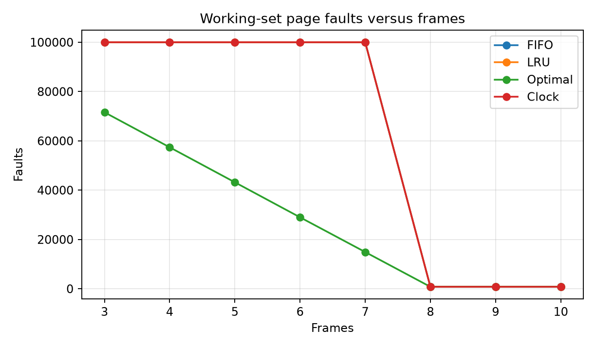

## Q5 - Page-replacement techniques (8 marks)

The provided TODO implementation in `Task05/lru_todo.c` completes LRU by choosing the resident frame with the smallest last-use index. Verified results for the 20-reference handout are: 3 frames FIFO 15, LRU 12, Optimal 9; 4 frames FIFO 10, LRU 8, Optimal 8. For Belady's string `{1,2,3,4,1,2,5,1,2,3,4,5}`, FIFO faults rise from 9 with 3 frames to 10 with 4. FIFO forgets access recency, so adding a frame changes queue replacement order and can evict a page needed soon. LRU is a stack algorithm: pages resident with k frames form a subset of those resident with k+1 frames, so it cannot suffer this anomaly. Optimal replaces the page whose next use is farthest in the future; it is a lower bound, but future references are unknowable online.

`replacement_lab.c` builds deterministic 100,000-reference strings: strong locality (repeated eight-page windows, shifting every 1,000 references) and random access over 4,096 pages. It compares faults and elapsed time for FIFO, exact LRU, Optimal and Clock at 3-10 frames; `evidence/task05-replacement.csv` is used for the plotted data. With 8 frames, all policies produce 800 faults on the locality trace; with 4 frames they incur 100,000 faults because the eight-page working set does not fit. For random access with 4 frames, FIFO/LRU/Clock each incur 100,000 faults and Optimal incurs 99,928. LRU needs hardware/software recency ordering or timestamps updated on each hit; a timestamp implementation here costs O(frames) victim selection and O(1) hit update. The optimized Optimal simulator precomputes each reference's next use in O(n+page-domain) and chooses the farthest next use in O(frames) per miss; it is a benchmark bound, not an online policy. Clock keeps a reference bit per frame and advances a hand, clearing bits until a zero-bit victim is found; it approximates recency with small per-frame space and amortized scans instead of maintaining exact order. Strong locality should favor LRU/Clock; random access gives little recent-use advantage. For a production web server, recommend Clock or a segmented/working-set approximation: cheaper state and scans than exact LRU, and benchmarked against LRU/Optimal for the actual cache workload. Check `evidence/task05-replacement.csv` for counts and runtimes.

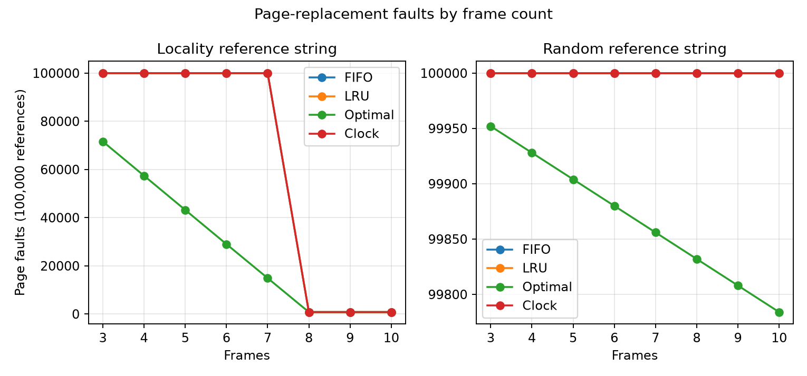

## Q6 - Disk management (4 marks)

Low-level formatting creates physical sectors (modern drives perform this internally); partitioning defines address ranges; logical formatting creates a filesystem's metadata and free-space structures. The boot block/EFI system partition holds bootloader code; firmware initializes hardware and selects it, the bootloader loads the kernel/initramfs, and the kernel discovers storage, mounts root and starts user space. Bad blocks are remapped by drive firmware where possible; filesystems/device layers can also mark unreadable blocks and relocate data from backups. Monitor SMART/health signals and replace failing media.

With six 4 TB disks, nominal usable capacities are: RAID 0 = 24 TB; RAID 1 as three mirrored pairs = 12 TB; RAID 5 = 20 TB; RAID 6 = 16 TB; RAID 10 as three mirrored pairs = 12 TB. RAID 0 offers aggregate throughput but no failure tolerance. RAID 1/10 provide mirror reads and tolerate one failure per mirror pair; writes go to both copies. RAID 5 tolerates one drive loss and has parity-write overhead; RAID 6 tolerates two and has additional parity cost. Capacity excludes filesystem/metadata and decimal-vs-binary presentation effects.

For a transparent independent annual disk-failure probability p=0.02 assumption, RAID 1/10 with three independent pairs loses data if both disks fail in any pair: `1-(1-p^2)^3`, or 0.12%. RAID 5 loses data if two or more of six fail: `1-(1-p)^6-6p(1-p)^5`, or 0.5687%. RAID 6 requires three or more failures, about 0.015291%. RAID 0 loses data if any disk fails, about 11.4158%. These simplified probabilities omit correlated failures, rebuild exposure, latent sector errors and controller/site failure; real risk is higher. The computed values are in `evidence/task06-raid.txt`.

Choose RAID 10 for this records server, assuming the nominal 12 TB usable capacity is sufficient: it gives predictable writes and straightforward mirror rebuilds, while tolerating one disk failure in each mirror pair. Keep independent offline/immutable backups and test restore; RAID is availability, not backup. For a concrete swap policy, assuming 64 GiB RAM and no hibernation, start with a 16 GiB encrypted swap file on the protected RAID 10 volume, reserve RAM for the database cache, and alert/throttle before sustained swap-in. Confirm capacity against measured peak and crash-dump policy before deployment; do not put swap on a single unmirrored disk or use it to mask a sustained RAM shortfall. If the data set cannot fit in 12 TB, choose RAID 6 and accept higher write/parity overhead.

Linux device/partition/swap data and a read-throughput sample of the runner's filesystem are in `evidence/task06-disk.txt`. This hosted runner exposes only its own virtualized storage path, not a matched SSD and HDD, so a true cross-device speed comparison was unavailable and is not fabricated. The file read result is labeled by filesystem/device evidence and should not be presented as an SSD-vs-HDD benchmark. In the 6x4 TB RAID 6 alternative, usable capacity is 16 TB, two failures are tolerated, and each write computes two parity values (higher CPU and I/O work than single parity); parity implementations use XOR plus a second independent coding operation such as Reed-Solomon.

## Q7 - First-principles edge-device memory plan (10 marks)

### Stage 1: measurable requirements

| Component | Budget / requirement | Page-fault tolerance |
|---|---|---|
| Real-time control | 128 MiB reserved and prefaulted; fixed loop must meet its deadline with zero demand faults | None during control cycle |
| ML inference | Up to 1,536 MiB model/working data; bounded latency target measured per model | Can tolerate startup/model-load faults; avoid faults in the inference window |
| Logging | 128 MiB bounded queue/cache; drop or rotate low-priority logs under pressure | Tolerates buffered storage delays |
| Kernel/services | 256 MiB planning allowance | Ordinary OS reclaim, outside the RT critical path |
| **Total** | **2,048 MiB; no swap** | Admission control required |

The control requirement is deadline-based: no page faults in the cyclic control path and a target-specific maximum loop delay (for example, 1 ms; the actual plant's safety analysis must set it). The ML task can be throttled or reduced; logging can shed data. Kernel memory is not a hard reservation in Linux, so deployment needs cgroups/reservations and validation under worst-case load.

### Stage 2: candidate mechanisms

| Mechanism | Real-time control | ML inference | Logging / future tasks |
|---|---|---|---|
| Contiguous allocation | Predictable placement but difficult to grow and external fragmentation | Large model can fail despite total free memory | Poor for many variable future tasks |
| Paging | Use fixed resident frames, prefault and `mlock`; enforce permissions | Flexible mapping, shared model pages, demand-load before run | Best general allocation and isolation |
| Segmentation | Natural code/data/stack protection, but variable physical segments fragment | Logical regions help organization | Growth and placement are harder |
| Demand paging | Not allowed in deadline path | Useful during model startup and cold data | Appropriate for noncritical logs/tools |

Lock the control working set with `mlock()` (or `mlockall(MCL_CURRENT|MCL_FUTURE)` after setting `RLIMIT_MEMLOCK`), prefault every page, disable unexpected allocation in the loop, isolate a CPU, use bounded priority scheduling and validate worst-case interrupt/driver behavior. The demonstration locks and prefaults a 16 KiB test hot set; the plan reserves 128 MiB for a real control image and would require sufficient process/system memlock limits.

### Stage 3: verification and evidence

`Task07/memory_plan.c` measures 5,000 hot-set iterations with and without `mlock`, reporting median, 99th-percentile and maximum observed loop duration. It simulates control, ML and logging page references with and without a pinned control working set. Here both modes measured p50 30 ns and p99 41 ns; the locked run had a 22,402 ns maximum outlier. The simulation reports four post-warmup control misses without pinning and zero with pinning. The runner permits only an 8 MiB memlock limit, so the demo locks a 16 KiB hot set rather than the planned 128 MiB reserve. This demonstrates the mechanism, not a hard real-time guarantee: a shared Linux kernel, interrupts and drivers can still create latency, and a finite observed maximum is not a formal worst-case bound. Run the test under representative thermal, I/O and CPU load on the actual device.

### Stage 4: defence and alternative

The plan assigns the fixed real-time hot set first, caps the ML working set to the remainder and makes logging the first reclaim/shedding target. A fourth 500 MiB task exceeds the 2 GiB budget by 500 MiB; do not reclaim control pages. Reduce/quantize the ML model, offload the fourth task, or add RAM and revalidate timing. One remaining limitation is that Linux cannot promise a strict no-delay bound solely from `mlock`; the device requires a real-time kernel/configuration and hardware-level deadline testing if missing a control deadline is unsafe.

On a small RTOS with no virtual memory, preallocate and statically partition the control buffers so paging delay is impossible and worst-case behavior is easier to bound. That leaves less flexible memory for the 1.5 GiB ML workload, and adding tasks requires redesigning fixed pools. Linux with locked control memory offers better dynamic sharing and service growth but needs careful isolation and cannot by itself give the same hard upper bound. The recorded locked/unlocked timings and frame-simulation result are in `evidence/task07-memory-plan.txt`.

## Evidence and reproduction

| Question | Source and retained output |
|---|---|
| Q1 | `Task01/`; `evidence/task01-linking.txt` |
| Q2 | `Task02/`; `evidence/task02-*` |
| Q3 | `Task03/`; `evidence/task03-segmentation.txt` |
| Q4 | `Task04/`; `evidence/task04-*` |
| Q5 | `Task05/`; `evidence/task05-*`; charts in `plots/` |
| Q6 | `Task06/`; `evidence/task06-*` |
| Q7 | `Task07/`; `evidence/task07-memory-plan.txt` |

Rebuild with `bash scripts/run_linux_evidence.sh` from `Assignment3/`. Measurements are from the Ubuntu CI runner and are system-specific; the disk and real-time limitations above are explicit. Reference concepts: Silberschatz, Galvin and Gagne, *Operating System Concepts*, 10th ed.; Linux `ld.so(8)`, `dlopen(3)`, `mmap(2)`, `mlock(2)`, `getrusage(2)`, `proc(5)` and `proc_pid_smaps(5)` manual pages.

## OnlineGDB output screenshot

This capture shows `Task05/replacement_lab.c` compiled and run in OnlineGDB. It includes the replacement-policy measurements, FIFO hand-check, and exit code 0. The raw result files remain in `evidence/`.

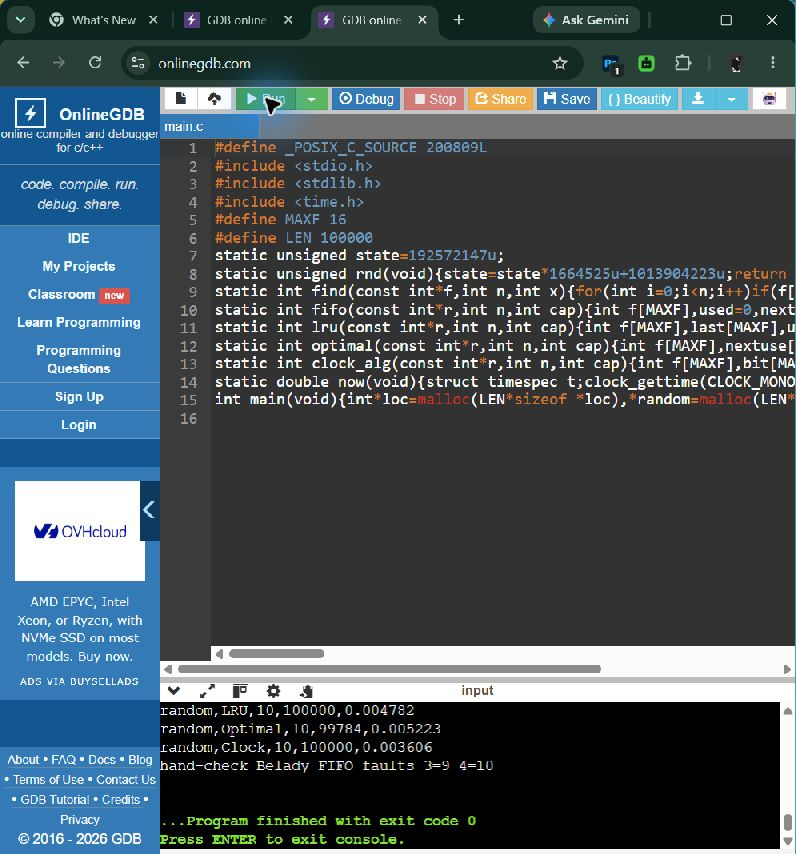
## Full OnlineGDB program runs

The complete task sources were entered into OnlineGDB. The linked-library task was run with both `main.c` and `crypto.c` present in the OnlineGDB project; the screenshots preserve the source/output views.

### Q1 — linking and loading

The linked program printed the crypto library version and checksum. The separate `dlopen` program requires a prebuilt `libbankcrypto.so`; OnlineGDB's normal single-run build does not create that shared object, so its screenshot records the missing-library diagnostic. The Ubuntu evidence directory contains the task's normal build and run artifacts.

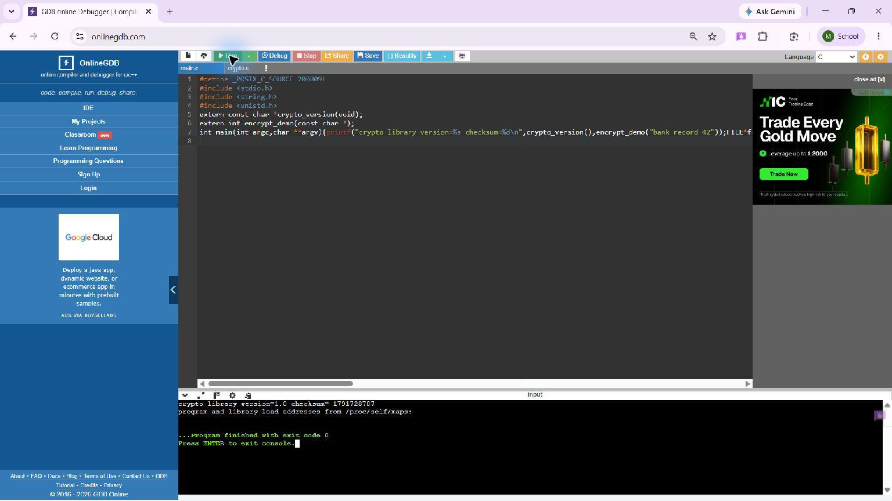

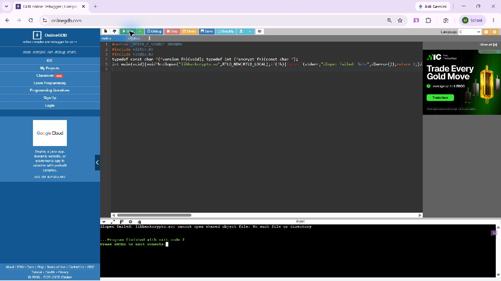

### Q2–Q4 — paging, segmentation and virtual memory

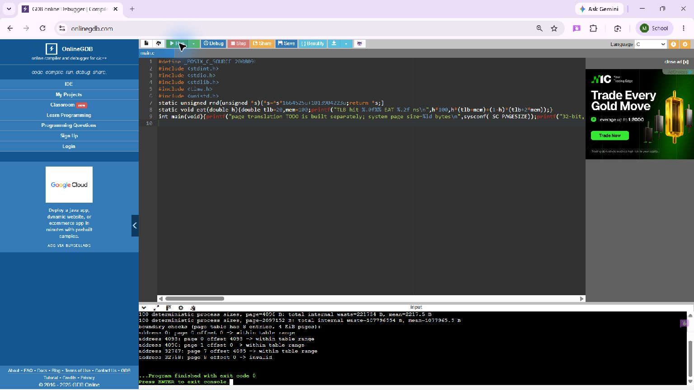

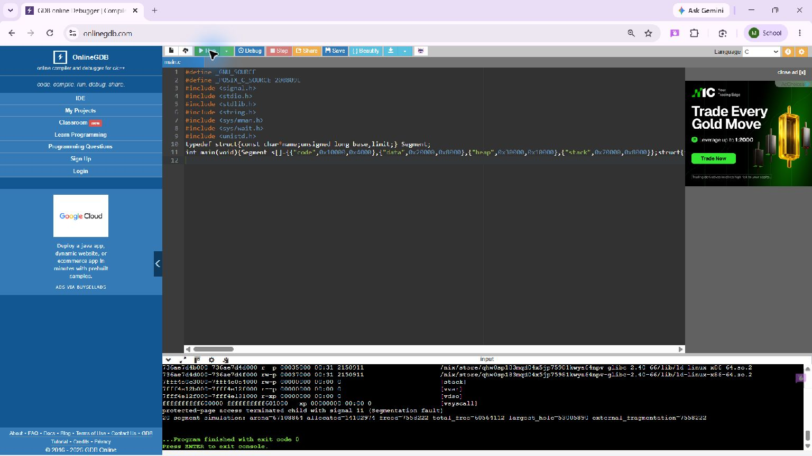

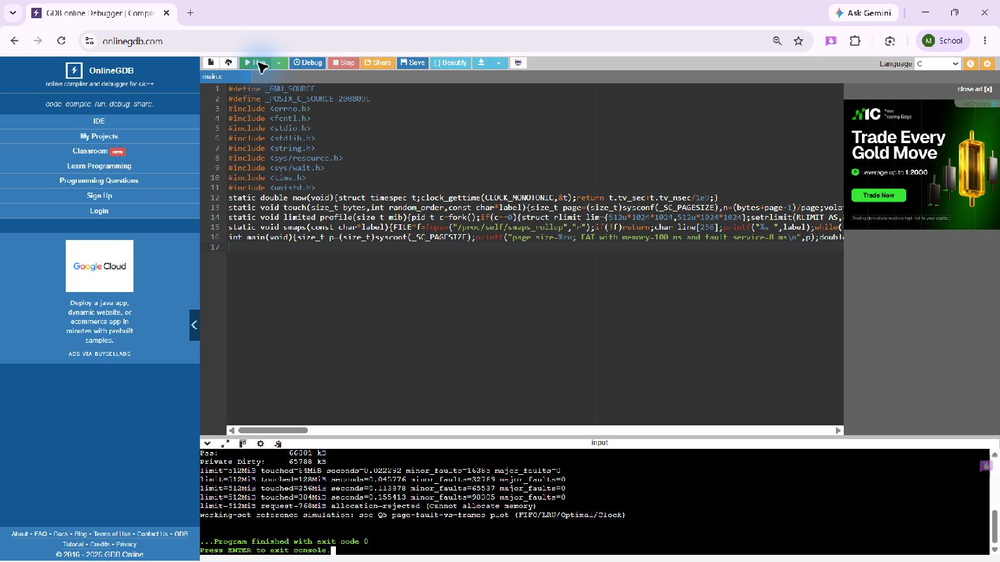

### Q5–Q7 — replacement, disk and memory planning

The replacement-policy run includes separate views for the locality table and the randomized benchmark/hand-check summary.

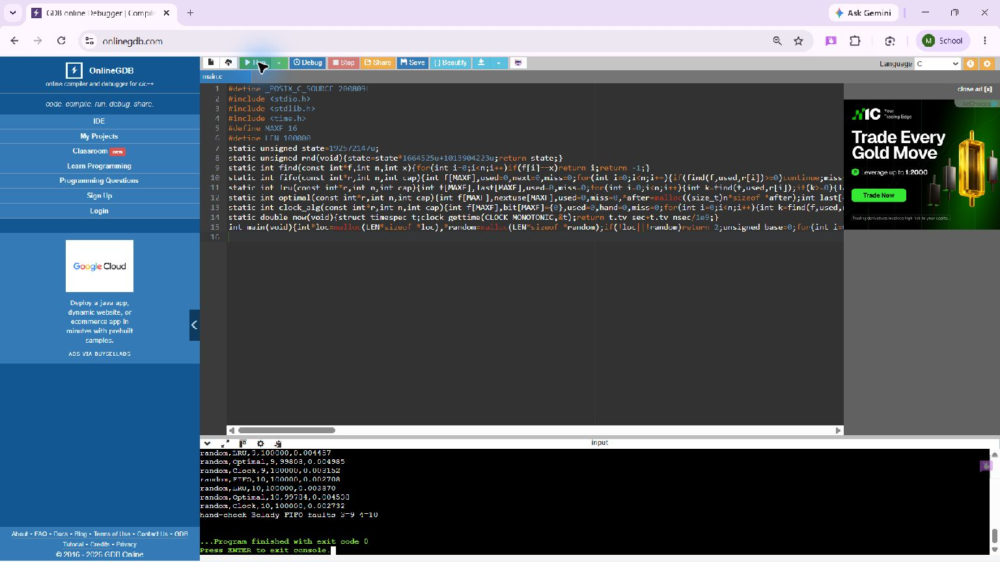

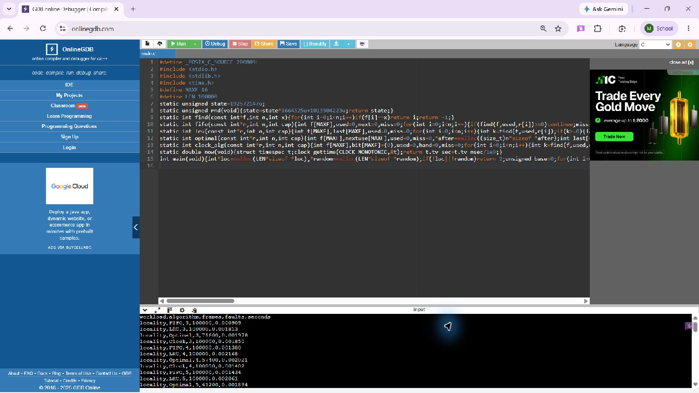


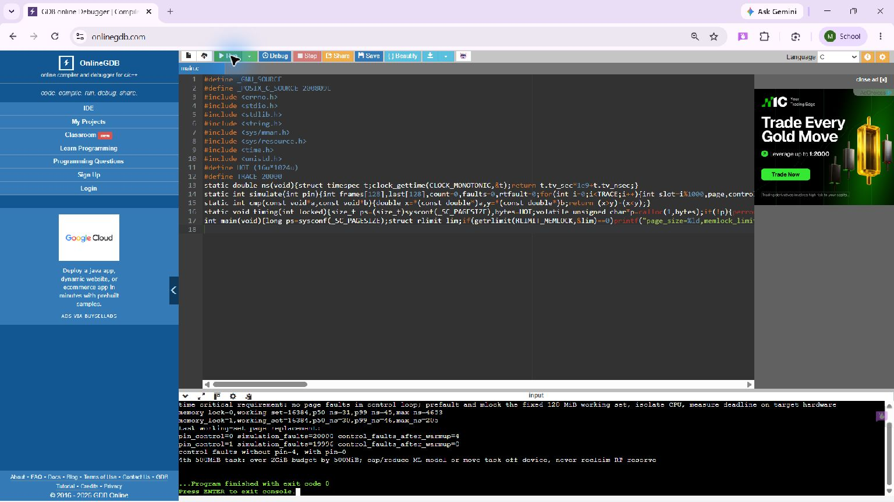

## Appendix - Full source code listings

This appendix reproduces all assignment programs, implementation scripts, and deployment/workflow configuration. Evidence screenshots and raw outputs appear earlier in this report and under `evidence/`. The exact source files are also retained at the listed repository paths. Report line wrapping is visual only.

### `scripts/plot_results.py`

```python
from pathlib import Path
import csv
import matplotlib.pyplot as plt

base=Path(__file__).resolve().parent.parent
rows=list(csv.DictReader((base/'evidence/task05-replacement.csv').open()))
names=['FIFO','LRU','Optimal','Clock']
fig,axes=plt.subplots(1,2,figsize=(9,4.2),sharey=False)
for ax,work in zip(axes,['locality','random']):
    for alg in names:
        data=[r for r in rows if r['workload']==work and r['algorithm']==alg]
        ax.plot([int(r['frames']) for r in data],[int(r['faults']) for r in data],marker='o',label=alg)
    ax.set_title(f'{work.title()} reference string');ax.set_xlabel('Frames');ax.set_xticks(range(3,11));ax.grid(True,alpha=.3);ax.legend()
axes[0].set_ylabel('Page faults (100,000 references)')
fig.suptitle('Page-replacement faults by frame count');fig.tight_layout();fig.savefig(base/'plots/replacement_faults.png',dpi=170)
fig,ax=plt.subplots(figsize=(7.2,4.2))
for alg in names:
    data=[r for r in rows if r['workload']=='locality' and r['algorithm']==alg]
    ax.plot([int(r['frames']) for r in data],[int(r['faults']) for r in data],marker='o',label=alg)
ax.set_title('Working-set page faults versus frames');ax.set_xlabel('Frames');ax.set_ylabel('Faults');ax.set_xticks(range(3,11));ax.grid(True,alpha=.3);ax.legend();fig.tight_layout();fig.savefig(base/'plots/page_faults.png',dpi=170)
```

### `scripts/run_linking.sh`

```bash
#!/usr/bin/env bash
set -euo pipefail
cd "$(dirname "$0")/.."
mkdir -p Task01/build/lib evidence
cd Task01/build
gcc -std=c11 -Wall -Wextra -pthread -DVERSION='"1.0"' -fPIC -shared ../crypto.c -o lib/libbankcrypto.so
gcc -std=c11 -Wall -Wextra -pthread -DVERSION='"1.0"' -c ../crypto.c -o crypto.o
ar rcs lib/libbankcrypto.a crypto.o
gcc -std=c11 -Wall -Wextra -pthread ../linked_demo.c lib/libbankcrypto.a -o linked_static
gcc -std=c11 -Wall -Wextra -pthread ../linked_demo.c -Llib -lbankcrypto -Wl,-rpath,'$ORIGIN/lib' -o linked_dynamic
gcc -std=c11 -Wall -Wextra -pthread ../dlopen_demo.c -ldl -o dlopen_demo
{
  echo 'gcc -std=c11 -Wall -Wextra -pthread -DVERSION="1.0" -fPIC -shared ../crypto.c -o lib/libbankcrypto.so'
  echo 'gcc -std=c11 -Wall -Wextra -pthread -DVERSION="1.0" -c ../crypto.c -o crypto.o; ar rcs lib/libbankcrypto.a crypto.o'
  echo 'gcc -std=c11 -Wall -Wextra -pthread ../linked_demo.c lib/libbankcrypto.a -o linked_static'
  echo 'gcc -std=c11 -Wall -Wextra -pthread ../linked_demo.c -Llib -lbankcrypto -Wl,-rpath,$ORIGIN/lib -o linked_dynamic'
  echo 'gcc -std=c11 -Wall -Wextra -pthread ../dlopen_demo.c -ldl -o dlopen_demo'
  echo 'Build and linking'; ls -lh linked_static linked_dynamic lib/libbankcrypto.so
  echo 'ldd static-library variant'; ldd linked_static
  echo 'ldd shared-library variant'; ldd linked_dynamic
  echo 'Startup batch (100 launches) and maximum RSS'; /usr/bin/time -f 'static 100 launches elapsed=%e s max_rss=%M KiB' bash -c 'for i in {1..100}; do ./linked_static >/dev/null; done'
  /usr/bin/time -f 'dynamic 100 launches elapsed=%e s max_rss=%M KiB' bash -c 'for i in {1..100}; do ./linked_dynamic >/dev/null; done'
  echo 'Run-time dlopen/dlsym'; LD_LIBRARY_PATH=lib ./dlopen_demo
  echo 'Initial dynamic program'; ./linked_dynamic
  echo 'Replace shared object only (no relink)'; gcc -std=c11 -Wall -Wextra -pthread -DVERSION='"2.0"' -fPIC -shared ../crypto.c -o lib/libbankcrypto.new.so; mv lib/libbankcrypto.new.so lib/libbankcrypto.so; ./linked_dynamic
  echo 'Static executable remains at original version'; ./linked_static
  ./linked_dynamic --hold > copy1.txt & p1=$!; sleep 0.2
  ./linked_dynamic --hold > copy2.txt & p2=$!; sleep 0.2
  echo "two processes: pid1=$p1 pid2=$p2; shared library mappings:" 
  for p in "$p1" "$p2"; do echo "PID $p"; awk '/libbankcrypto.so/ {show=1; print; next} /^[[:xdigit:]]+-/ {show=0} show && /Shared_Clean|Private_Clean/ {print}' "/proc/$p/smaps" | head -n 8; done
  wait "$p1"; wait "$p2"
  echo 'Missing shared-library failure test'; mv lib/libbankcrypto.so lib/libbankcrypto.so.missing
  set +e; LD_LIBRARY_PATH=lib ./linked_dynamic > missing-linked.txt 2>&1; rc1=$?; LD_LIBRARY_PATH=lib ./dlopen_demo > missing-dlopen.txt 2>&1; rc2=$?; set -e
  mv lib/libbankcrypto.so.missing lib/libbankcrypto.so
  printf 'linked exit=%d\n' "$rc1"; cat missing-linked.txt; printf 'dlopen exit=%d\n' "$rc2"; cat missing-dlopen.txt
} > ../../evidence/task01-linking.txt 2>&1
```

### `scripts/run_linux_evidence.sh`

```bash
#!/usr/bin/env bash
set -euo pipefail
cd "$(dirname "$0")/.."
mkdir -p evidence plots
{ . /etc/os-release; printf 'Linux: %s\nCompiler: ' "$PRETTY_NAME"; gcc --version | head -n1; getconf PAGESIZE | sed 's/^/System base page size: /'; } | tee evidence/build-environment.txt
bash scripts/run_linking.sh
for spec in 'Task02/paging_todo.c:Task02/paging_todo' 'Task02/paging_lab.c:Task02/paging_lab' 'Task03/segment_lab.c:Task03/segment_lab' 'Task04/virtual_memory.c:Task04/virtual_memory' 'Task05/lru_todo.c:Task05/lru_todo' 'Task05/replacement_lab.c:Task05/replacement_lab' 'Task06/disk_analysis.c:Task06/disk_analysis' 'Task07/memory_plan.c:Task07/memory_plan'; do
  src=${spec%%:*}; bin=${spec#*:}; command="gcc -std=c11 -Wall -Wextra -pthread $src -o $bin"
  if [[ "$src" == Task06/* ]]; then command="$command -lm"; fi
  echo "$command" | tee -a evidence/build-environment.txt
  eval "$command"
done
run_capture(){ echo "Run $1"; timeout 120s "$1" > "$2" 2>&1; }
run_capture Task02/paging_todo evidence/task02-todo-1024.txt
sed 's/#define PAGE_SIZE 1024/#define PAGE_SIZE 2048/' Task02/paging_todo.c > Task02/paging_todo_2048.c
gcc -std=c11 -Wall -Wextra Task02/paging_todo_2048.c -o Task02/paging_todo_2048
run_capture Task02/paging_todo_2048 evidence/task02-todo-2048.txt
run_capture Task02/paging_lab evidence/task02-paging.txt
/usr/bin/time -v Task02/paging_lab >/dev/null 2> evidence/task02-time.txt
run_capture Task03/segment_lab evidence/task03-segmentation.txt
ulimit -c 0
/usr/bin/time -v Task04/virtual_memory > evidence/task04-memory.txt 2> evidence/task04-time.txt
run_capture Task05/lru_todo evidence/task05-todo.txt
run_capture Task05/replacement_lab evidence/task05-replacement.csv
run_capture Task06/disk_analysis evidence/task06-raid.txt
{
  echo 'Linux block devices (ROTA=1 rotational, 0 non-rotational):'; lsblk -dn -o NAME,ROTA,TYPE,SIZE || true
  echo 'Partitions:'; (sudo -n fdisk -l 2>&1 || fdisk -l 2>&1 || true)
  echo 'Filesystem and swap:'; findmnt -T /tmp -o SOURCE,FSTYPE,TARGET; swapon --show
  tmpfile=$(mktemp /tmp/os-disk-read.XXXXXX); dd if=/dev/zero of="$tmpfile" bs=1M count=32 conv=fsync status=none
  echo 'Read speed of runner filesystem file (not classified as SSD/HDD unless lsblk identifies the device):'
  /usr/bin/time -f 'elapsed=%e s max_rss=%M KiB' dd if="$tmpfile" of=/dev/null bs=1M
  rm -f "$tmpfile"
} > evidence/task06-disk.txt 2>&1
run_capture Task07/memory_plan evidence/task07-memory-plan.txt
python3 scripts/plot_results.py
grep -q 'physical 5120' evidence/task02-todo-1024.txt
grep -q 'Belady string, FIFO: 3 frames 9 faults, 4 frames 10 faults' evidence/task05-todo.txt
grep -q '3 frames: FIFO 15, LRU 12, Optimal 9' evidence/task05-todo.txt
grep -q 'control faults without pin=.* with pin=0' evidence/task07-memory-plan.txt
test -s plots/replacement_faults.png && test -s plots/page_faults.png
echo 'All Assignment 3 programs ran and key expected-output checks passed.' | tee evidence/verification.txt
```

### `Task01/crypto.c`

```c
#include <stdio.h>
#ifndef VERSION
#define VERSION "1.0"
#endif
const char *crypto_version(void) { return VERSION; }
const unsigned char crypto_sbox[65536] = {1};
int encrypt_demo(const char *input) { unsigned sum=0; for (const unsigned char *p=(const unsigned char *)input; *p; ++p) sum=(sum*33u)^*p; return (int)(sum + crypto_sbox[sum & 65535u]); }
```

### `Task01/dlopen_demo.c`

```c
#define _POSIX_C_SOURCE 200809L
#include <dlfcn.h>
#include <stdio.h>
typedef const char *(*version_fn)(void); typedef int (*encrypt_fn)(const char *);
int main(void){void*h=dlopen("libbankcrypto.so",RTLD_NOW|RTLD_LOCAL);if(!h){fprintf(stderr,"dlopen failed: %s\n",dlerror());return 2;}dlerror();version_fn version=(version_fn)dlsym(h,"crypto_version");const char*e=dlerror();if(e){fprintf(stderr,"dlsym version failed: %s\n",e);dlclose(h);return 3;}encrypt_fn encrypt=(encrypt_fn)dlsym(h,"encrypt_demo");e=dlerror();if(e){fprintf(stderr,"dlsym encrypt failed: %s\n",e);dlclose(h);return 3;}printf("runtime-loaded version=%s checksum=%d\n",version(),encrypt("bank-record-42"));dlclose(h);return 0;}
```

### `Task01/linked_demo.c`

```c
#define _POSIX_C_SOURCE 200809L
#include <stdio.h>
#include <string.h>
#include <unistd.h>
extern const char *crypto_version(void);
extern int encrypt_demo(const char *);
int main(int argc,char **argv){printf("crypto library version=%s checksum=%d\n",crypto_version(),encrypt_demo("bank-record-42"));FILE*f=fopen("/proc/self/maps","r");if(f){char line[512];puts("program and library load addresses from /proc/self/maps:");while(fgets(line,sizeof line,f))if(strstr(line,"linked_demo")||strstr(line,"libbankcrypto"))fputs(line,stdout);fclose(f);}if(argc>1&&strcmp(argv[1],"--hold")==0){printf("pid=%ld holding mappings\n",(long)getpid());fflush(stdout);sleep(3);}return 0;}
```

### `Task02/paging_lab.c`

```c
#define _POSIX_C_SOURCE 200809L
#include <stdint.h>
#include <stdio.h>
#include <stdlib.h>
#include <time.h>
#include <unistd.h>
static unsigned rnd(unsigned *s){*s=*s*1664525u+1013904223u;return *s;}
static void eat(double h){double tlb=20,mem=100;printf("TLB hit %.0f%% EAT %.2f ns\n",h*100,h*(tlb+mem)+(1-h)*(tlb+2*mem));}
int main(void){printf("page translation TODO is built separately; system page size=%ld bytes\n",sysconf(_SC_PAGESIZE));printf("32-bit, 4KiB pages: 2^20 entries x 4 B = 4 MiB (flat table)\n48-bit, 4KiB pages: 2^36 entries x 8 B = 512 GiB (flat table; canonical user range may be smaller)\n");eat(.80);eat(.95);eat(.99);const unsigned ps[]={1024,4096,2097152};unsigned seed=192572147u;for(int j=0;j<3;j++){unsigned long long waste=0;for(int i=0;i<100;i++){size_t size=1+(rnd(&seed)%50000000u);waste+=(ps[j]-(size%ps[j]))%ps[j];}printf("100 deterministic process sizes, page=%u B: total internal waste=%llu B, mean=%.1f B\n",ps[j],waste,(double)waste/100);}int a[]={0,4095,4096,32767,32768};puts("boundary checks (page table has 8 entries, 4 KiB pages):");for(int i=0;i<5;i++){unsigned pg=(unsigned)a[i]/4096,off=(unsigned)a[i]%4096;printf("address %d: page %u offset %u -> %s\n",a[i],pg,off,pg>=8?"invalid":"within table range");}return 0;}
```

### `Task02/paging_todo.c`

```c
#include <stdio.h>
#define PAGE_SIZE 1024
#define PAGES 8
int page_table[PAGES] = {5, 2, -1, 7, 0, -1, 3, -1};
int main(void)
{
    unsigned logical[] = {0, 1500, 3100, 6200, 9000, 2049};
    for (int i = 0; i < 6; i++) {
        unsigned a = logical[i];
        unsigned p = a / PAGE_SIZE;
        unsigned d = a % PAGE_SIZE;
        if (p >= PAGES) printf("%5u -> page %u offset %4u : invalid address\n", a, p, d);
        else if (page_table[p] == -1) printf("%5u -> page %u offset %4u : page fault\n", a, p, d);
        else printf("%5u -> page %u offset %4u : physical %u\n", a, p, d,
                    (unsigned)page_table[p] * PAGE_SIZE + d);
    }
    return 0;
}
```

### `Task03/segment_lab.c`

```c
#define _GNU_SOURCE
#define _POSIX_C_SOURCE 200809L
#include <signal.h>
#include <stdio.h>
#include <stdlib.h>
#include <string.h>
#include <sys/mman.h>
#include <sys/wait.h>
#include <unistd.h>
typedef struct{const char*name;unsigned long base,limit;} Segment;
int main(void){Segment s[]={{"code",0x10000,0x4000},{"data",0x20000,0x8000},{"heap",0x30000,0x10000},{"stack",0x70000,0x8000}};struct{int seg;unsigned long off;} a[]={{0,0},{0,16383},{1,4100},{2,8192},{3,32},{1,32767},{2,65535},{3,32768}};puts("segment,offset,limit,result");for(int i=0;i<8;i++){int n=a[i].seg;printf("%s,%lu,%lu,",s[n].name,a[i].off,s[n].limit);if(a[i].off>=s[n].limit)puts("protection fault (offset >= limit)");else printf("physical-linear 0x%lx\n",s[n].base+a[i].off);}puts("segmentation + paging: logical (segment,offset) -> segment base+offset -> page number/offset -> frame+offset -> physical address");FILE*f=fopen("/proc/self/maps","r");if(f){char line[512];puts("this process /proc maps:");while(fgets(line,sizeof line,f))fputs(line,stdout);fclose(f);}pid_t c=fork();if(c==0){volatile char*p=mmap(NULL,4096,PROT_NONE,MAP_PRIVATE|MAP_ANONYMOUS,-1,0);if(p==MAP_FAILED)_exit(2);*p=1;_exit(0);}int st;waitpid(c,&st,0);if(WIFSIGNALED(st))printf("protected-page access terminated child with signal %d (%s)\n",WTERMSIG(st),strsignal(WTERMSIG(st)));else printf("protection test child exit=%d\n",WEXITSTATUS(st));unsigned seed=71;size_t sizes[20],used=0,arena=64u*1024u*1024u;for(int i=0;i<20;i++){seed=seed*1103515245u+12345u;sizes[i]=65536+(seed%2000000);used+=sizes[i];}size_t freed=0,largest=arena-used;for(int i=0;i<20;i+=2){freed+=sizes[i];if(sizes[i]>largest)largest=sizes[i];}printf("20 segment simulation: arena=%zu allocated=%zu freed=%zu total_free=%zu largest_hole=%zu external_fragmentation=%zu\n",arena,used,freed,arena-used+freed,largest,arena-used+freed-largest);return 0;}
```

### `Task04/virtual_memory.c`

```c
#define _GNU_SOURCE
#define _POSIX_C_SOURCE 200809L
#include <errno.h>
#include <fcntl.h>
#include <stdio.h>
#include <stdlib.h>
#include <string.h>
#include <sys/resource.h>
#include <sys/wait.h>
#include <time.h>
#include <unistd.h>
static double now(void){struct timespec t;clock_gettime(CLOCK_MONOTONIC,&t);return t.tv_sec+t.tv_nsec/1e9;}
static void touch(size_t bytes,int random_order,const char*label){size_t page=(size_t)sysconf(_SC_PAGESIZE),n=(bytes+page-1)/page;volatile unsigned char*p=calloc(n,page);if(!p){perror("calloc");return;}unsigned long seed=192572147;struct rusage a,b;getrusage(RUSAGE_SELF,&a);double t=now();for(size_t i=0;i<n;i++){size_t k=i;if(random_order){seed=seed*1664525+1013904223;k=(seed% n);}p[k*page]=(unsigned char)i;}double elapsed=now()-t;getrusage(RUSAGE_SELF,&b);printf("%s,%zu,%.6f,%ld,%ld,checksum=%u\n",label,bytes,elapsed,b.ru_minflt-a.ru_minflt,b.ru_majflt-a.ru_majflt,p[(n-1)*page]);free((void*)p);}
static void limited_profile(size_t mib){pid_t c=fork();if(c==0){struct rlimit lim={512u*1024*1024,512u*1024*1024};setrlimit(RLIMIT_AS,&lim);size_t bytes=mib*1024u*1024u,page=(size_t)sysconf(_SC_PAGESIZE);volatile unsigned char*p=malloc(bytes);if(!p){printf("limit=512MiB request=%zuMiB allocation=rejected (%s)\n",mib,strerror(errno));fflush(stdout);_exit(0);}struct rusage a,b;getrusage(RUSAGE_SELF,&a);double t=now();for(size_t i=0;i<bytes;i+=page)p[i]=1;double elapsed=now()-t;getrusage(RUSAGE_SELF,&b);printf("limit=512MiB touched=%zuMiB seconds=%.6f minor_faults=%ld major_faults=%ld\n",mib,elapsed,b.ru_minflt-a.ru_minflt,b.ru_majflt-a.ru_majflt);fflush(stdout);_exit(0);}int st;waitpid(c,&st,0);}
static void smaps(const char*label){FILE*f=fopen("/proc/self/smaps_rollup","r");if(!f)return;char line[256];printf("%s ",label);while(fgets(line,sizeof line,f))if(!strncmp(line,"Rss:",4)||!strncmp(line,"Pss:",4)||!strncmp(line,"Private_Dirty:",14))printf("%s",line);fclose(f);fflush(stdout);}
int main(void){size_t p=(size_t)sysconf(_SC_PAGESIZE);printf("page size=%zu; EAT with memory=100 ns and fault service=8 ms\n",p);double rates[]={1e-3,1e-5,1e-6};for(int i=0;i<3;i++)printf("fault rate %.8f EAT %.3f ns\n",rates[i],(1-rates[i])*100+rates[i]*(8000000+100));printf("10%% slowdown maximum page-fault rate=%.9f (about 1 per 800000 references)\n",10.0/7999900.0);puts("pattern,bytes,seconds,minor_fault_delta,major_fault_delta,checksum");touch(64u*1024*1024,0,"sequential");touch(64u*1024*1024,1,"random");size_t bytes=64u*1024*1024;unsigned char*mem=malloc(bytes);if(mem){memset(mem,1,bytes);smaps("parent before fork:");int ready[2];pipe(ready);pid_t c=fork();if(c==0){close(ready[0]);smaps("child before write:");for(size_t i=0;i<bytes;i+=p)mem[i]++;smaps("child after COW writes:");write(ready[1],"x",1);_exit(0);}close(ready[1]);char token;read(ready[0],&token,1);waitpid(c,NULL,0);smaps("parent after child writes:");free(mem);}size_t profile[]={64,128,256,384,768};for(size_t i=0;i<5;i++)limited_profile(profile[i]);printf("working-set reference simulation: see Q5 page-fault-vs-frames plot (FIFO/LRU/Optimal/Clock)\n");return 0;}
```

### `Task05/lru_todo.c`

```c
#include <stdio.h>
#define MAXF 8
int find(const int f[], int n, int page)
{
    for (int i = 0; i < n; i++) if (f[i] == page) return i;
    return -1;
}
int fifo(const int ref[], int len, int frames)
{
    int f[MAXF], used = 0, next = 0, faults = 0;
    for (int i = 0; i < len; i++) {
        if (find(f, used, ref[i]) >= 0) continue;
        faults++;
        if (used < frames) f[used++] = ref[i];
        else { f[next] = ref[i]; next = (next + 1) % frames; }
    }
    return faults;
}
int lru(const int ref[], int len, int frames)
{
    int f[MAXF], last[MAXF], used = 0, faults = 0;
    for (int i = 0; i < len; i++) {
        int k = find(f, used, ref[i]);
        if (k >= 0) { last[k] = i; continue; }
        faults++;
        if (used < frames) { k = used++; f[k] = ref[i]; }
        else { k = 0; for (int j = 1; j < frames; j++) if (last[j] < last[k]) k = j; f[k] = ref[i]; }
        last[k] = i;
    }
    return faults;
}
int optimal(const int ref[], int len, int frames)
{
    int f[MAXF], used = 0, faults = 0;
    for (int i = 0; i < len; i++) {
        if (find(f, used, ref[i]) >= 0) continue;
        faults++;
        if (used < frames) { f[used++] = ref[i]; continue; }
        int victim = 0, farthest = -1;
        for (int j = 0; j < frames; j++) {
            int next = len;
            for (int t = i + 1; t < len; t++) if (ref[t] == f[j]) { next = t; break; }
            if (next > farthest) { farthest = next; victim = j; }
        }
        f[victim] = ref[i];
    }
    return faults;
}
int main(void)
{
    int ref[] = {7, 0, 1, 2, 0, 3, 0, 4, 2, 3, 0, 3, 2, 1, 2, 0, 1, 7, 0, 1};
    int len = 20;
    for (int fr = 3; fr <= 4; fr++)
        printf("%d frames: FIFO %d, LRU %d, Optimal %d\n", fr, fifo(ref, len, fr),
               lru(ref, len, fr), optimal(ref, len, fr));
    int b[] = {1, 2, 3, 4, 1, 2, 5, 1, 2, 3, 4, 5};
    printf("Belady string, FIFO: 3 frames %d faults, 4 frames %d faults\n",
           fifo(b, 12, 3), fifo(b, 12, 4));
    return 0;
}
```

### `Task05/replacement_lab.c`

```c
#define _POSIX_C_SOURCE 200809L
#include <stdio.h>
#include <stdlib.h>
#include <time.h>
#define MAXF 16
#define LEN 100000
static unsigned state=192572147u;
static unsigned rnd(void){state=state*1664525u+1013904223u;return state;}
static int find(const int*f,int n,int x){for(int i=0;i<n;i++)if(f[i]==x)return i;return -1;}
static int fifo(const int*r,int n,int cap){int f[MAXF],used=0,next=0,miss=0;for(int i=0;i<n;i++){if(find(f,used,r[i])>=0)continue;miss++;if(used<cap)f[used++]=r[i];else{f[next]=r[i];next=(next+1)%cap;}}return miss;}
static int lru(const int*r,int n,int cap){int f[MAXF],last[MAXF],used=0,miss=0;for(int i=0;i<n;i++){int k=find(f,used,r[i]);if(k>=0){last[k]=i;continue;}miss++;if(used<cap){k=used++;f[k]=r[i];}else{k=0;for(int j=1;j<cap;j++)if(last[j]<last[k])k=j;f[k]=r[i];}last[k]=i;}return miss;}
static int optimal(const int*r,int n,int cap){int f[MAXF],nextuse[MAXF],used=0,miss=0,*after=malloc((size_t)n*sizeof *after);int last[4096];if(!after)return -1;for(int p=0;p<4096;p++)last[p]=n;for(int i=n-1;i>=0;i--){after[i]=last[r[i]];last[r[i]]=i;}for(int i=0;i<n;i++){int k=find(f,used,r[i]);if(k>=0){nextuse[k]=after[i];continue;}miss++;if(used<cap)k=used++,f[k]=r[i];else{k=0;for(int j=1;j<cap;j++)if(nextuse[j]>nextuse[k])k=j;f[k]=r[i];}nextuse[k]=after[i];}free(after);return miss;}
static int clock_alg(const int*r,int n,int cap){int f[MAXF],bit[MAXF]={0},used=0,hand=0,miss=0;for(int i=0;i<n;i++){int k=find(f,used,r[i]);if(k>=0){bit[k]=1;continue;}miss++;if(used<cap){f[used]=r[i];bit[used++]=1;continue;}while(bit[hand]){bit[hand]=0;hand=(hand+1)%cap;}f[hand]=r[i];bit[hand]=1;hand=(hand+1)%cap;}return miss;}
static double now(void){struct timespec t;clock_gettime(CLOCK_MONOTONIC,&t);return t.tv_sec+t.tv_nsec/1e9;}
int main(void){int*loc=malloc(LEN*sizeof *loc),*random=malloc(LEN*sizeof *random);if(!loc||!random)return 2;unsigned base=0;for(int i=0;i<LEN;i++){if(i%1000==0)base=rnd()%4096;loc[i]=(int)((base+(unsigned)i%8)%4096);random[i]=(int)(rnd()%4096);}int(*fn[])(const int*,int,int)={fifo,lru,optimal,clock_alg};const char*names[]={"FIFO","LRU","Optimal","Clock"};puts("workload,algorithm,frames,faults,seconds");for(int w=0;w<2;w++){const int*r=w?random:loc;const char*wn=w?"random":"locality";for(int cap=3;cap<=10;cap++)for(int a=0;a<4;a++){double t=now();int faults=fn[a](r,LEN,cap);double elapsed=now()-t;printf("%s,%s,%d,%d,%.6f\n",wn,names[a],cap,faults,elapsed);}}int sample[]={1,2,3,4,1,2,5,1,2,3,4,5};printf("hand-check Belady FIFO faults 3=%d 4=%d\n",fifo(sample,12,3),fifo(sample,12,4));free(loc);free(random);return 0;}
```

### `Task06/disk_analysis.c`

```c
#include <stdio.h>
#include <math.h>
int main(void){double d=4.0,p=.02;printf("6 disks x %.0f TB, assumed independent annual disk failure probability %.1f%%\n",d,p*100);printf("RAID0 usable %.0f TB, one-disk failure data-loss probability %.6f\n",6*d,1-pow(1-p,6));printf("RAID1 (three mirrored pairs) usable %.0f TB, loss probability %.6f\n",3*d,1-pow(1-p*p,3));printf("RAID5 usable %.0f TB, loss probability %.6f\n",5*d,1-pow(1-p,6)-6*p*pow(1-p,5));printf("RAID6 usable %.0f TB, loss probability (>=3 failures) %.8f\n",4*d,1-pow(1-p,6)-6*p*pow(1-p,5)-15*p*p*pow(1-p,4));printf("RAID10 usable %.0f TB, loss probability %.6f\n",3*d,1-pow(1-p*p,3));return 0;}
```

### `Task07/memory_plan.c`

```c
#define _GNU_SOURCE
#define _POSIX_C_SOURCE 200809L
#include <errno.h>
#include <stdio.h>
#include <stdlib.h>
#include <string.h>
#include <sys/mman.h>
#include <sys/resource.h>
#include <time.h>
#include <unistd.h>
#define HOT (16u*1024u)
#define TRACE 20000
static double ns(void){struct timespec t;clock_gettime(CLOCK_MONOTONIC,&t);return t.tv_sec*1e9+t.tv_nsec;}
static int simulate(int pin){int frames[128],last[128],count=0,faults=0,rtfault=0;for(int i=0;i<TRACE;i++){int slot=i%1000,page,control=(slot==0);if(control)page=(i/1000)%16;else if(slot<990)page=100+(int)((i*1103515245u+12345u)%256);else page=400+(i%24);int k=-1;for(int j=0;j<count;j++)if(frames[j]==page)k=j;if(k<0){faults++;if(control&&i>=16000)rtfault++;if(count<128){k=count++;frames[k]=page;}else{int v=-1;for(int j=0;j<128;j++){if(pin&&frames[j]>=0&&frames[j]<16)continue;if(v<0||last[j]<last[v])v=j;}if(v<0)return -1;k=v;frames[k]=page;}}last[k]=i;}printf("pin_control=%d simulation_faults=%d control_faults_after_warmup=%d\n",pin,faults,rtfault);return rtfault;}
static int cmp(const void*a,const void*b){double x=*(const double*)a,y=*(const double*)b;return (x>y)-(x<y);}
static void timing(int locked){size_t ps=(size_t)sysconf(_SC_PAGESIZE),bytes=HOT;volatile unsigned char*p=calloc(1,bytes);if(!p){perror("calloc");return;}if(locked&&mlock((const void*)p,bytes)){printf("mlock failed: %s\n",strerror(errno));free((void*)p);return;}for(size_t i=0;i<bytes;i+=ps)p[i]=1;double samples[5000],worst=0;for(int k=0;k<5000;k++){double a=ns();for(size_t i=0;i<bytes;i+=ps)p[i]++;double d=ns()-a;samples[k]=d;if(d>worst)worst=d;}qsort(samples,5000,sizeof samples[0],cmp);printf("memory_lock=%d,working_set=%zu,p50_ns=%.0f,p99_ns=%.0f,max_ns=%.0f\n",locked,bytes,samples[2500],samples[4950],worst);if(locked)munlock((const void*)p,bytes);free((void*)p);}
int main(void){long ps=sysconf(_SC_PAGESIZE);struct rlimit lim;if(getrlimit(RLIMIT_MEMLOCK,&lim)==0)printf("page_size=%ld,memlock_limit=%llu bytes\n",ps,(unsigned long long)lim.rlim_cur);puts("memory budget MiB: control 128 (locked reserve), ML 1536, logging 128, OS/services 256 = 2048; no swap");puts("time-critical requirement: no page faults in control loop; prefault and mlock the fixed 128 MiB working set, isolate CPU, measure deadline on target hardware");timing(0);timing(1);puts("task working-set page replacement:");int a=simulate(0),b=simulate(1);printf("control faults without pin=%d, with pin=%d\n",a,b);puts("4th 500MiB task: over 2GiB budget by 500MiB; cap/reduce ML model or move task off device, never reclaim RT reserve");return b==0?0:1;}
```
