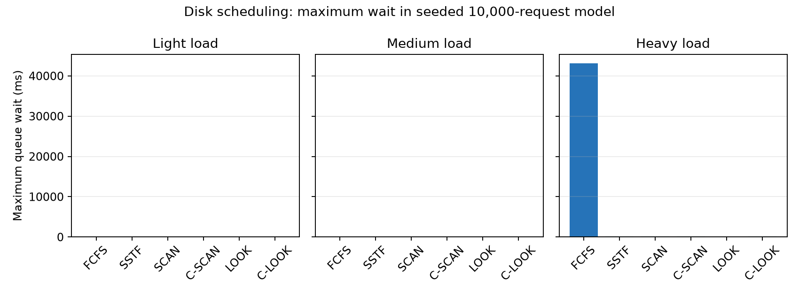
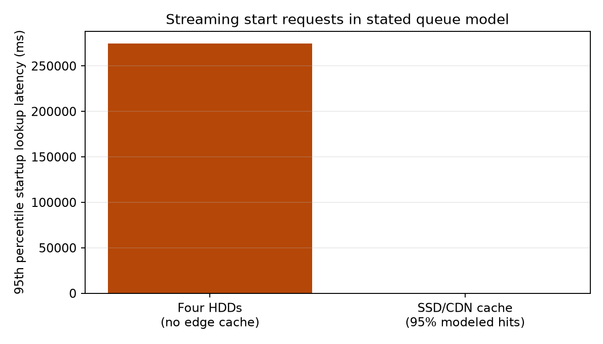

# CSA0406 Operating Systems - Assignment 4 (CO4)

## Cover

**Assignment:** Optimise File Storage and Disk Access  
**Student:** Mohamed Aslam H  
**Register number:** 192572147  
**Department:** CSE (AI)  
**Academic year:** 2025  
**Faculty:** Dr. Jayasakthi Velmurugan K  
**Nature:** Individual  
**Course repository:** https://github.com/Md-Aslam-31/CSA0406-Operating_System/tree/main/Assignment4  
**Execution environment:** Ubuntu 24.04 LTS and GCC 13 on GitHub Actions. This folder is in the existing course repository to keep Assignments 1-4 together. Run details and outputs are in evidence/.

## Executive summary

Use per-student directories, explicit ACLs and audited group shares instead of a flat unprotected folder. For surveillance files, use indexed/extent allocation so time offsets remain addressable while files grow, and keep a 30-day retention job. ext4 is a sound Linux database default; select other filesystems for device compatibility, snapshots or end-to-end checksums. The provided allocation exercise has a mismatch: its expected output says the 10-block contiguous allocation succeeds at block 19, while a following sentence claims it cannot fit. The code and output agree: 13 adjacent blocks remain there, so it does fit. I retain the expected output and add a separate fragmented example where indexed allocation solves a real contiguous-space failure. For scheduling, compare seek movement and queue wait under a stated deterministic model. For 200,000 stream viewers, a CDN edge cache is needed to meet aggregate bandwidth; keep replicated origins and SSD hot data behind it.

## T1 - File-system design review (6 marks)

The proposal has at least six weaknesses: user-chosen names collide; a flat namespace is harder to delegate and may need linear search O(n); contiguous extents can fail growth and fragment free space; no ACL permits cross-student disclosure; backups/recovery/retention are unspecified; and sharing through copies creates stale versions. A directory index can improve name lookup toward O(log n) or hashed expected O(1), but does not fix privacy or ownership.

The design in Task01/design.md uses /srv/student-files/<register-prefix>/<register-number>/... for private data and /groups/<course>/<project>/ for collaboration. Register number plus server-generated object ID supplies stable identity; original names remain metadata. Private directories default to mode 0700; staff and group membership use scoped ACLs, audited grants, quotas, timestamps, checksums, MIME type and retention tags. Acyclic tree directories preserve simple traversal; project ACLs grant same-object sharing. Encrypted immutable backups live in a separate failure domain and restores are tested.

### Privacy defence (under 100 words)

Every personal directory is owned by its student and has private default permissions; the service checks identity and ACLs on every open. Staff receive course-scoped access only when required and access is audited. A project group gets a dedicated shared directory with an explicit membership ACL, so collaborators edit the same current files without exposing personal folders. Backups preserve permissions and are encrypted. Filenames do not grant access, and changing a link cannot bypass server-side authorization.

### Alternative: managed cloud drive

Use institution-managed accounts, SSO/MFA, group drives, versioning, retention, audit logs and geographic/legal controls. An indexed name lookup is typically O(log N) or a key lookup O(1) average, then opening adds network/authentication latency; caching can improve repeat reads. Space grows O(D+V) with live bytes D and retained versions V; provider replication is hidden in the service charge, while explicit offline copies use additional storage. The college controls identity policy and contracts but delegates disk placement, repair and filesystem internals to the provider. Measure search/open p95 across campus and home networks and verify export and recovery before migration.

## T2 - Allocation for the video recorder (8 marks)

### Operations and choice

32 cameras create one append-only growing file per camera, sequential writes continuously, sequential playback/export, occasional indexed seeks by timestamp, and deletion/metadata updates after 30 days. A time-to-file index maps camera+timestamp to byte offset. Extent/indexed allocation supports growth and random offset lookup; preallocate near-term extents to limit fragmentation, keep an index/extent map, and use checksums. A retention service deletes whole expired files, not arbitrary blocks within active recordings.

| Method | Sequential and direct reads | Growth and fragmentation | Reliability |
|---|---|---|---|
| Contiguous/extents | Very fast sequential; direct block = start + offset/block size, O(1) | File extension needs adjacent space or extent tree; external free-space holes can prevent growth | Few metadata pointers; a corrupt extent loses affected range |
| Linked blocks | Sequential follows pointers; block k needs k link reads; direct access is O(k) | Easy append and no external fragmentation; pointer stored with each block | A damaged pointer can lose the rest of the chain |
| FAT-linked | Sequential follows FAT entries; if FAT is resident, k steps are RAM lookups; arbitrary block still O(k) | Easy growth, but one huge central table consumes RAM and is a metadata hotspot | FAT corruption can disconnect many chains; keep redundant FAT/checks |
| Indexed/inode extents | Sequential and direct access are efficient; with an indexed tree, lookup is O(log n) metadata or a few levels | Easy non-contiguous growth; tree/index blocks add metadata | Checksummed/redundant metadata can limit damage; more indirection than contiguous |

### 4 GiB file cost and inode maximum

Assume binary 4 GiB file = 4,294,967,296 bytes, 4 KiB = 4,096-byte blocks and exclude directory/inode lookup from the comparison. The file has 1,048,576 blocks.

* Contiguous: calculate the final block address; 1 target data-block read.
* On-disk linked pointers: follow preceding links then read data, about 1,048,576 block reads in the worst case.
* FAT held fully in RAM: 1,048,575 RAM next-pointer lookups, then 1 target data read. If FAT is not cached, FAT block reads also occur.
* Indexed tree with 1,024 four-byte pointers per 4 KiB index block: use a root plus one leaf for this 1,048,576-block file, then read the target data block: 2 index reads + 1 data read on a cold path. A cached root or leaf reduces the count.

For an inode with 12 direct, 1 single, 1 double and 1 triple indirect pointer, a 4 KiB pointer block stores 4,096/4 = 1,024 addresses. Maximum addressable blocks = 12 + 1,024 + 1,024^2 + 1,024^3 = 1,074,791,436. At 4 KiB/block that is 4,402,345,721,856 bytes, about 4.004 TiB. This is a pointer-format limit before filesystem, device, reserved-block and implementation limits.

For a decimal 4 TB disk with 4 KiB blocks, there are 976,562,500 whole blocks. A bit vector needs ceil(blocks/8) = 122,070,313 bytes (116.42 MiB). A linked free list uses a pointer per free block but discovers free blocks by traversal; grouping stores batches of block addresses per free block; counting stores start+length for runs and is compact for contiguous free ranges. A FAT with one 4-byte entry per block would require about 3.64 GiB resident, illustrating why a global full FAT is costly at this scale. Task02/allocation_lab.c prints these values.

### Completed allocation code and consistency note

Task02/allocation_todo.c replaces only the requested TODO, uses first fit and matches the supplied expected output. After releasing B and D, the disk has 21 free blocks, including a 13-block run at 19-31; therefore alloc_contiguous('E',10) succeeds at block 19. This contradicts the assignment sentence claiming it cannot be stored contiguously. The later indexed allocation is a second E allocation: after the first E uses 19-28, exactly 11 free blocks remain (8 at 6-13 and 3 at 29-31), enough for one index block plus ten data blocks. Task02/fragmentation_demo.c separately constructs 17 free blocks with largest run 7; a 10-block contiguous file fails but indexed allocation succeeds. This demonstrates the intended fragmentation concept without altering the handout program.

### Alternative: in-memory FAT

With a FAT resident, traversal to k still takes O(k) RAM table lookups and one final data read; an inode extent/index tree takes O(log n) or a few index reads. FAT memory for 4 TB decimal/4 KiB blocks is around 3.64 GiB for 4-byte entries. A damaged FAT can break many unrelated files, so checksummed redundant copies and repair logs are necessary. Contiguous access is O(1) address arithmetic but has growth/fragmentation costs.

## T3 - Modern file systems (9 marks)

Limits vary with format versions, cluster/block sizes, OS support and hardware. The table gives common/practical figures or explains when a universal figure is misleading.

| File system | File / volume scale | Journal or consistency | Snapshots | Checksums | CoW |
|---|---|---|---|---|---|
| FAT32 | File <4 GiB; common Windows volume limit 2 TiB (format/OS dependent) | No journal; power loss can leave allocation chains inconsistent | No | No end-to-end data checksums | No |
| NTFS | Modern Windows default 4 KiB cluster: up to 16 TB; larger clusters support much larger volumes/files (Windows-version dependent) | Metadata journal via NTFS log | VSS/Windows snapshots are external services, not general filesystem snapshots | No general end-to-end file-data checksum | No for ordinary data; metadata updates logged |
| ext4 | 4 KiB blocks: max extent file 16 TiB; 32-bit filesystem ceiling 16 TiB, 64-bit format theoretical ceiling 64 ZiB | JBD2 metadata journal; journal, ordered (default) and writeback modes | External LVM/storage snapshot | Metadata/journal checksums supported; file data not generally checksummed by default | No general data CoW |
| XFS | Very large, commonly up to 8 EiB theoretical file/filesystem ceilings; kernel/device formats bound real use | Metadata log/journal; recovery replays log | External LVM/storage snapshot; reflink shares extents but is not a full snapshot service | V5 metadata checksums | Reflink/CoW for shared extents; ordinary overwrite behavior depends on feature/use |
| Btrfs | 16 EiB format file limit; Linux VFS practical file limit 8 EiB; filesystem is device/capacity bound | Transactional CoW consistency rather than a traditional metadata journal | Native subvolume snapshots | Data and metadata checksums by default | Yes |
| ZFS | 16 EiB theoretical file limit; pool limits are implementation/platform dependent | Transactional CoW tree; no journal replay required for consistency | Native dataset snapshots/clones | End-to-end block checksums; can self-heal with redundancy | Yes |
| APFS | Published Apple guide: file size up to 2^63 bytes (8 EiB); usable container is hardware/OS bounded | CoW metadata and atomic updates | Native snapshots | Public user documentation does not promise general end-to-end data checksums | Yes, metadata and clones/snapshots |

### Power loss and ext4 modes

A partially written block may contain old/new mixed data if a device tears writes; filesystem metadata can otherwise point to incomplete allocations. A journal writes a transaction record and replays committed metadata after reboot. data=journal writes data and metadata through the journal (extra writes, strongest data ordering). data=ordered journals metadata and flushes associated data blocks before committing metadata; it is the usual default. data=writeback journals metadata but does not preserve data-before-metadata ordering, so recently written files can expose stale contents after a crash. Journaling helps metadata consistency; it is not a backup or a guarantee that an application-level multi-file transaction is atomic. CoW filesystems write new blocks and switch a root/pointer atomically, preserving an older tree until commit. End-to-end checksums detect corruption; redundancy may repair it.

### Device choices

* **Windows and Linux pen drive:** exFAT for large cross-platform files and broad modern OS support; FAT32 only when legacy device compatibility matters and files stay below 4 GiB. Safely eject and keep a second copy because neither is a backup.
* **Linux database server:** ext4 with barriers/flush semantics and monitored backups is a mature, low-overhead default. Benchmark XFS for very large parallel files. Evaluate Btrfs/ZFS if snapshots and end-to-end integrity are required, after database direct-I/O/fsync compatibility tests.
* **Laptop:** NTFS for a Windows-only laptop; APFS for a Mac. Use full-disk encryption and versioned backups.
* **Snapshot backup server:** ZFS with redundant vdevs, scheduled snapshots, scrubs and off-site replication; Btrfs is a Linux alternative. Snapshots on the same pool do not protect against pool/site loss.

### Real filesystem inspection

Task03/inspect_filesystem.sh records stat, df -i, ls -i, findmnt and dumpe2fs -h. GitHub's job filesystem may be an overlay instead of a directly addressable ext4 block device; the script reports its host mount and creates a 64 MiB ext4 image to inspect block size, inode/free-space counts and features with dumpe2fs. This provides genuine Linux ext4 superblock evidence without pretending the runner root is a physical ext4 disk. On a directly accessible ext4 host, it also attempts tune2fs -l.

### Alternative: Btrfs/ZFS for database

CoW small random overwrites allocate new blocks and update a logarithmic tree path (O(log N) metadata writes by tree height), which can add write amplification and fragmentation compared with ext4 in-place data updates plus a journal transaction. Checksums consume metadata/CPU and snapshots retain changed blocks: if fraction f of a dataset changes between snapshots, incremental retained payload is roughly f times dataset size (plus metadata), not a full copy; long retention or high churn can approach multiple dataset copies. A snapshot root is created in O(1) metadata operations. Transactional tree recovery avoids a long metadata journal replay, but application recovery and database WAL replay still take time. Benchmark transaction latency, fsync, discard, compression and snapshot churn using the actual database; keep backups separate.

## T4 - Disk scheduling (7 marks)

For cylinders 0-199, head=53, queue 98,183,37,122,14,124,65,67. Initial direction for SCAN/LOOK is toward 0; for C-SCAN/C-LOOK it is toward 199. Count physical movement, including the C-SCAN/C-LOOK wrap.

| Policy | Service order (edge/wrap shown) | Movement |
|---|---|---:|
| FCFS | 98,183,37,122,14,124,65,67 | 640 |
| SSTF | 65,67,37,14,98,122,124,183 | 236 |
| SCAN | 37,14,0,65,67,98,122,124,183 | 236 |
| C-SCAN | 65,67,98,122,124,183,199,0,14,37 | 382 (=183 service travel +199 wrap) |
| LOOK | 37,14,65,67,98,122,124,183 | 208 |
| C-LOOK | 65,67,98,122,124,183,14,37 | 322 (includes 183-to-14 wrap) |

The handout's completed SSTF program prints 236. Its C-SCAN expected output displays 183 cylinders plus the 199-cylinder wrap separately; total physical movement is 382.

Task04/scheduler_sim.c simulates 10,000 seeded arrivals on cylinders 0-199, with light/medium/heavy arrival intervals 30/10/3 ms. The explicit model uses 0.08 ms per cylinder and 2 ms service per request. It reports average head movement, average queue wait and maximum queue wait for all six policies. These are deterministic model measurements, not measurements of a physical disk. FCFS is fair in arrival order but can have long seeks. SSTF minimizes immediate distance but can starve distant requests under a sustained closer stream. SCAN/LOOK bound directional waits better; LOOK avoids traveling to an unused edge. C-SCAN gives more uniform directional service intervals than SCAN by treating the return as a wrap, at the cost of jump movement. The simulation appends 200 requests at cylinder 60 every millisecond to show SSTF can leave a request at 183 waiting at least 400 ms in its stated 2 ms service model; an unending closer stream has no finite SSTF wait bound.

For SSDs, mechanical seek reordering has little benefit. Linux's none leaves ordering largely to hardware/blk-mq; mq-deadline can enforce latency/fairness without pretending seeks dominate. Task04/inspect_scheduler.sh records lsblk, each available /sys/block/*/queue/scheduler and device rotation flags. The actual hosted runner result is in evidence/task04-device.txt.

### Alternative: LOOK and C-LOOK complexity

At a batch of n pending requests, a simple scan for the nearest or last request costs O(n); sorting the queue once costs O(n log n), after which selection is O(1) or O(log n) insertion. The given queue: LOOK moves 208 cylinders, C-LOOK moves 322 including wrap. Wait depends on arrival times and service rate, so report queue measurements from the provided simulator rather than infer an average from total seek distance alone. Compared with SCAN/C-SCAN, LOOK/C-LOOK avoid empty travel to physical edges.

## T5 - Distributed and cloud storage (7 marks)

NFS offers a familiar shared filesystem and is simplest for home directories; HA configuration and cache semantics matter. HDFS is optimized for large sequential write-once/read-many files; a common replication factor three costs roughly 3x storage. Ceph distributes object/file/block storage and provides scaling/failure-domain choices but needs operational expertise. Cloud object storage is key/API-based, highly available and elastic, but charges for stored versions, requests, retrieval and egress and is not a POSIX filesystem by itself.

Replication keeps copies on separate nodes/racks. One failed device can be replaced from surviving replicas; copies in the same rack or site do not survive that domain's loss. Strong consistency makes acknowledged writes visible to later reads under the documented scope; eventual consistency allows temporary stale views and requires conflict handling. The OS uses device drivers to translate block requests, buffering to smooth rates, page-cache for repeated reads/writes, I/O schedulers to merge/order queued work, spooling for queued device jobs, and a block-device interface exposing logical block requests. Flushes and write-cache behavior affect durability.

### One NFS server alternative

With N users each demanding R bytes/s and server/link capacity B, ideal per-user throughput is bounded by B/N = O(1/N) after saturation while aggregate throughput remains O(B). One copy costs O(D) and three replicas cost O(3D); actual throughput falls as queues and metadata contention grow. One data copy is storage efficient; RAID/backups cost more but are not automatically independent service replicas. If the single server fails, all clients lose access until repair; clustered HA improves availability but needs shared metadata, fencing and tested failover. For example, a 10 Gbit/s link is 1.25 GB/s before overhead; 1,000 readers at 2 MB/s require 2 GB/s and saturate it. Three distributed replicas use about 3x space but provide parallel reads and node-failure tolerance. A separate immutable/off-site backup is still needed.

## T6 - Streaming startup design (13 marks)

### Stage 1: workload and measurable targets

Uploads occur once per video; reads dominate, most views happen during week one, and a minute seek is a random offset followed by sequential chunk reads. Design scenario: 10,000 videos averaging 1 GiB, 200,000 possible students, 20,000 simultaneous viewers at 4 Mbit/s. Test peak delivery of 20,000 x 4 Mbit/s = 80 Gbit/s; with a measured 95% CDN cache hit ratio, origin egress target is at most 4 Gbit/s. Test p95 first-frame startup under 3 seconds from each campus/region, correct seek to the requested minute, and no lost acknowledged uploads after one node failure. Those targets must be validated with real users and video profiles.

### Stages 2-3: architecture and decisions

Store authoritative video objects in a replicated origin across three failure-separated nodes. Each node has two 16 TB disks mirrored (16 TB decimal usable per node), enough for a 10.74 TB decimal catalog plus staging/headroom; three nodes hold three logical copies. Keep a 3 TiB NVMe/SSD hot cache for videos trending in week one; fill by popularity and evict cold items. Put a CDN in front of origin for campus/home delivery. Use ext4 or XFS on Linux origin nodes with 4 KiB filesystem blocks, extent allocation and 1 MiB HTTP segments. File offset indexes map timestamps to segment offsets. Use none/mq-deadline on NVMe; validate scheduler for the disk. Replication factor 3 across nodes; mirrored disks address a separate local disk failure. Alert on cache hit below 95%, origin saturation, checksum/replica lag and p95 startup.

    Upload -> checksum/metadata validation -> 3 mirrored origin nodes
                                               |
                                        3 TiB SSD hot cache
                                               |
                                   CDN edges in campus regions
                                               |
                                  campus and home viewers

### Stage 4: capacity, bandwidth and seek cost

Logical catalog = 10,000 x 1 GiB = 10,000 GiB = 9.77 TiB (10.74 TB decimal). Three logical copies require 30,000 GiB =29.30 TiB (32.21 TB decimal), excluding filesystem and staging overhead. At 20,000 users x4 Mbit/s, aggregate egress is 80 Gbit/s. A 95% edge hit ratio leaves 4 Gbit/s average origin egress; three 10 GbE origin links have nominal capacity 30 Gbit/s before overhead. The CDN must be provisioned for the full 80 Gbit/s and validated for cache misses and flash crowds.

At 4 Mbit/s, a 1 MiB segment represents about 2.10 seconds of playback. A random time seek calculates the target segment/byte offset, follows the inode extent index (one or a few metadata reads on a cold path), then issues a contiguous segment read: typically 1 data read when metadata is cached, or about 2-3 disk reads cold depending on extent-tree depth. A 2-hour video has about 3,600/2.10 =1,714 such segments. A 4 KiB allocation block means each 1 MiB segment covers 256 filesystem blocks.

For a cloud-only alternative, assumed (not vendor quote) catalog storage at $0.023/GiB-month costs 10,000 x 0.023 = $230/month. If each of 200,000 users watches two hours/month at 4 Mbit/s, delivery is 200,000 x 3.6 decimal GB = 720,000 GB; at an illustrative $0.05/GB egress, transfer is $36,000/month before CDN discounts, requests, cache tiers, taxes and regional pricing. Replace both unit rates with a current quote for the deployment region. Near-edge cache lowers start latency across cities; cloud/CDN reduces hardware operations but shifts cost to egress/requests and requires configuration, access control, cache invalidation and vendor governance.

### Stage 5: two-design simulation

Task06/streaming_sim.c compares a four-HDD origin directly serving a burst of 100,000 random 1 MiB segments at 2,000 starts/s against a modeled 95%-hit SSD/CDN edge with the same HDD origin. The simulation uses 8 ms seek + 180 MiB/s HDD transfer, 0.15 ms SSD seek + 1,800 MiB/s transfer, and 20 ms edge RTT. It reports p50/p95/p99/max request-start latency and origin reads; results are in evidence/task06-simulation.txt and charted in plots/streaming_latency.png. It measures the stated queue model, not a physical benchmark. A remote city should use a nearby CDN edge: with a modeled 20 ms RTT and 1 MiB buffer, the first-buffer transfer bound at 4 Mbit/s is about 2.1 seconds; a distant user without an edge adds WAN RTT and cannot be promised the same p95. Real evaluation should replay a representative popularity trace against fio or production-like storage and measure CDN hit ratio/RTT from multiple campuses.

## Reproduction and evidence

Run all experiments on Ubuntu with GCC:

    bash scripts/run_linux_evidence.sh

The runner compiles every C program with gcc -std=c11 -Wall -Wextra -pthread, captures output under evidence/, generates figures under plots/, and checks key expected output. The GitHub Actions link is in Assignment4/README.md. All algorithms have source, deterministic inputs and results retained. Values that depend on filesystem, kernel, queue parameters or assumed prices are labeled as such.

### References

* Microsoft Learn, [NTFS overview](https://learn.microsoft.com/windows-server/storage/file-server/ntfs-overview) and [filesystem functionality comparison](https://learn.microsoft.com/windows/win32/fileio/filesystem-functionality-comparison).
* Linux kernel, [ext4 documentation](https://www.kernel.org/doc/html/latest/admin-guide/ext4.html) and [XFS documentation](https://docs.kernel.org/next/admin-guide/xfs.html).
* [Btrfs documentation](https://btrfs.readthedocs.io/en/stable/btrfs-man5.html), [OpenZFS copy-on-write](https://openzfs.github.io/openzfs-docs/Basic%20Concepts/Copy-on-write.html), and [Apple APFS overview](https://support.apple.com/en-asia/guide/security/seca6147599e/web) and the [published APFS size table](https://developer.apple.com/library/archive/documentation/FileManagement/Conceptual/APFS_Guide/VolumeFormatComparison/VolumeFormatComparison.html).
* Apache Hadoop, [HDFS architecture guide](https://hadoop.apache.org/docs/r3.4.3/hadoop-project-dist/hadoop-hdfs/HdfsDesign.html); AWS, [S3 consistency model](https://docs.aws.amazon.com/AmazonS3/latest/userguide/Welcome.html).
