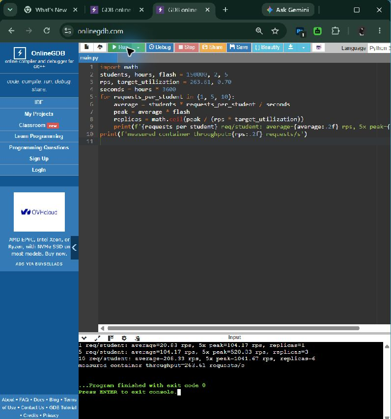
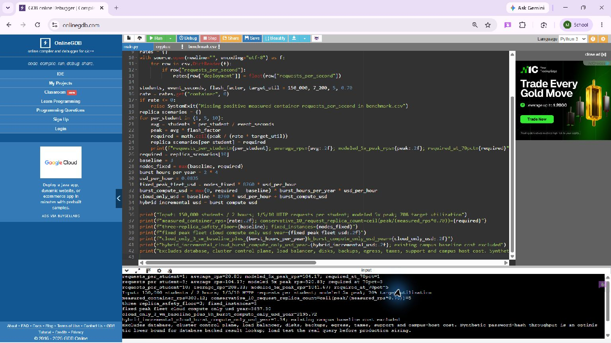

# CSA0406 Operating Systems - Assignment 5 (CO5)

## Evaluate Linux, Containers and Virtualisation for the University Result Portal

**Student:** Mohamed Aslam H  
**Register number:** 192572147  
**Department / section:** CSE (AI)  
**Academic year:** 2025  
**Faculty:** Dr. Jayasakthi Velmurugan K  
**Nature:** Individual  
**Course repository:** [Assignment 5 folder](https://github.com/Md-Aslam-31/CSA0406-Operating_System/tree/main/Assignment5)  
**Linux run evidence:** [successful Ubuntu CI run](https://github.com/Md-Aslam-31/CSA0406-Operating_System/actions/runs/45236369527)

## Executive summary

The assignment builds a small synthetic result portal and follows the requested workflow: understand Linux, design administration, virtualise, containerise, orchestrate, measure, interpret, and decide. The code contains no actual student result data or credentials. The Linux workflow records host observations, runs a hardened systemd service behind Nginx, executes the completed awk exercise and cron schedule, builds and inspects four container image variants, measures the Flask application directly and in Docker, attempts a QEMU guest run, then deploys it to a three-node kind cluster and verifies pod recovery and scaling under load. On the hosted runner QEMU TCG booted the Ubuntu guest and started cloud-init, but the application health check did not become reachable within 360 seconds; the VM result is clearly marked unavailable, not presented as a successful benchmark.

The engineering decision is a hybrid: keep routine traffic and a three-replica baseline on the university's existing machines, then provision cloud capacity before each of the two annual result releases. Keep the authoritative records behind a private database endpoint with encryption, backups and audited access. The measured request rate and computed replica/cost table are in `evidence/benchmark.csv` and `evidence/b4-capacity-cost.txt`; all figures are specific to this hosted test and must not be presented as a capacity guarantee for the real database-backed portal.

## Part A - Design (25 marks)

### A1 - Evaluate Linux system components (7 marks)

#### Linux architecture

Linux names the kernel. A distribution adds system libraries (such as glibc), a shell, utilities and package-management tools. Applications call kernel services through system calls; the kernel schedules processes, maps virtual memory, enforces files and credentials, drives devices and implements network sockets. The VFS dispatches common path/open/read/write operations to a mounted file system. A Flask process and Nginx proxy run in user space, so neither can directly issue disk or NIC instructions. This boundary reduces accidental hardware access, although a kernel/driver defect can affect every process on the host.

#### Process, memory and observation

The task asks for the Completely Fair Scheduler (CFS): its virtual-runtime model tries to give runnable tasks a fair CPU share and uses an ordered run queue. Linux's current documentation says CFS is making room for EEVDF. EEVDF still aims at fair sharing, but selects an eligible task by virtual deadline and lag. Therefore this report explains CFS as the assignment topic and captures the actual Ubuntu kernel version rather than implying that every current kernel uses the original CFS implementation unchanged.

The page cache uses available RAM to retain file data and is reclaimable when programs need memory. `MemAvailable`, major faults, swap-in/out and `vmstat` are more useful pressure indicators than `free` RAM alone. Swap can bridge a short peak but is much slower than memory. `/proc` exposes per-process and kernel counters; `/sys` exposes device/driver attributes and tunables. The evidence uses read-only observations and does not change host scheduling or memory settings.

#### Files and permissions

`/etc` stores configuration, `/var/log` logs, `/home` user data, `/srv` service data, `/usr` installed software, `/run` volatile runtime files, while `/proc` and `/sys` expose kernel state. Owner/group/other mode bits can be extended with ACLs and capabilities. Setuid executables run with the file owner's effective identity and should be rare. `sudo` grants selected administrative commands with auditing; the web worker uses a dedicated non-login identity instead of root.

#### Windows Server alternative

The comparable headless installation is Windows Server Core; Desktop Experience adds a GUI and more packages. Memory and disk consumption depend on edition, roles, updates and image, so compare a clean VM using `Get-CimInstance Win32_OperatingSystem` and `Get-Volume` instead of making an unsupported universal claim. Server Core has a smaller disk footprint than Desktop Experience. Ubuntu 24.04's published installation minimum is 1.5 GB RAM and 5 GB disk, not a web-application sizing recommendation.

PowerShell/DSC or Windows Admin Center can automate Windows services, but Windows uses different service, firewall and remote-management tooling from systemd, Nginx and shell scripts. Microsoft's Windows Server 2025 Standard reference price is USD $1,176 for a 16-core license; CALs are additional. Datacenter is $6,771 for 16 cores. Prices vary by country and reseller. For this Python stack, Linux avoids a per-server Windows license and has direct integration with the selected tools; Windows can be justified when campus identity integration, support or Windows-only software offsets license and operating cost.

### A2 - Design system administration (5 marks)

**Identities and privilege:** use named human accounts, MFA-backed SSH keys and groups such as `portal-ops`, `portal-readonly` and `db-ops`. Avoid shared administrator accounts. Run the portal as `result-portal` with `/usr/sbin/nologin`; PostgreSQL owns its data as a separate service account. Review membership and sudo logs. Store secrets in an approved secret store, not Git or command history.

**Service and logs:** `TaskB1/result-portal.service` uses two Gunicorn workers, a dedicated account, restart-on-failure, a restrictive umask, private temporary storage, read-only system paths and no Linux capabilities. Nginx is the only public HTTP entry and proxies to `127.0.0.1:8000`; production terminates TLS at Nginx or a managed load balancer. Forward journald and Nginx access/error logs to central storage. Alert on failed health checks, repeated 5xx, disk above 80%, swap pressure and certificate expiry. Retain student identifiers only under the university retention policy.

**Network:** use DHCP reservation/IPAM for private node addresses and managed DNS for the portal name. Publish only the load balancer. Default-deny inbound traffic; permit SSH only from VPN/bastion and TCP 80/443 at the web edge. Disable SSH password and root login. Keep PostgreSQL on a private subnet accepting only portal nodes. The CI firewall evidence uses only TCP 22, 80 and 443; a production rule should restrict port 22 to the campus management CIDR.

**Automation:** rotate logs, renew certificates, take encrypted database-consistent backups, test restores, check health and disk, and verify replication. `TaskB1/cron.txt` installs the hourly disk alert under the service account. systemd timers are a better production default for missed-run handling and journal integration.

**Ansible alternative:** `TaskA2/ansible/site.yml` expresses packages, account, files, service and firewall as desired state and runs in batches of five. A one-host hand-written setup may take an illustrative 15-30 minutes. Applying and checking k shell steps serially to 20 hosts is O(20k) operator actions and can take 5-10 engineer-hours, with configuration drift risk. Ansible has an illustrative 1-2 hour upfront role/inventory/key setup; with parallelism p, wall time is approximately O(k + n/p) batches (total machine work remains O(nk)). Idempotent modules make repeat runs converge. A faulty role can also propagate quickly, so use staging, code review and limited rollout batches. These are planning estimates, not a measurement on 20 campus servers.

### A3 - Evaluate virtualisation (5 marks)

Type-1 hypervisors manage physical hosts or provide a privileged host-kernel virtualization layer: examples include KVM, ESXi, Xen and Hyper-V. Type-2 hypervisors such as VirtualBox and VMware Workstation are applications hosted by a general-purpose OS. Full virtualization presents virtual devices to an unmodified guest; Intel VT-x or AMD-V accelerates guest execution. Paravirtual drivers such as virtio provide efficient I/O paths without changing the application.

VMs add kernel-level isolation, consolidate services, support controlled snapshots and may live-migrate when storage/network and processor compatibility allow it. They also consume RAM for each guest kernel/cache, add virtual I/O and need separate image backup and guest patching. A type-2 VM is convenient for student laptops and compatibility labs. Its CPU work passes through the host scheduler, while I/O crosses virtual devices and host paths; memory includes the host OS and each guest OS. Production should use a managed KVM/type-1 host or cloud VM rather than a desktop VirtualBox host. The comparative run labels KVM or QEMU TCG mode; TCG results are software emulation and cannot stand in for hardware-assisted VM performance.

For one VM, provisioning is O(1) operator workflow; maintaining n independent guest OSes still involves O(n) patch and backup streams. A type-1 cluster costs more to design initially, but centralized APIs allow scheduling and migration across hosts. VM count does not remove per-guest security maintenance.

### A4 - Evaluate containerisation (4 marks)

Linux namespaces scope a container's view of process IDs, mounts, network, IPC, hostname and users. cgroups account for and constrain CPU, memory and I/O. An image is an immutable stack of content-addressed layers; a container adds a writable layer. Containers share the host kernel, unlike VMs. This gives quick start and high density, but a host-kernel escape or weak privilege setup can cross container boundaries.

`TaskB2/Dockerfile` completes the worksheet: it sets `/app`, installs cached dependencies, copies the app, declares 8000, runs as `portal` and starts Gunicorn on `0.0.0.0:8000`. `Dockerfile.multistage` copies only installed runtime packages from its builder stage. Compose runs portal and PostgreSQL with a named database volume, health check, restart policy and CPU/memory caps. `docker history`, `docker image inspect`, `docker stats` and the `whoami` command provide layer, size, usage/limit and non-root evidence.

Use containers for the stateless web workers, with read-only filesystem, dropped capabilities, pinned/updated images and network policies. Use a managed database or a separately isolated VM for authoritative records. VMs provide a stronger separate-kernel boundary but add guest boot and memory. One VM per web/database service also creates O(n) guest patch streams; an image plus container scheduler centralizes common runtime changes. Actual overheads are measured below rather than inferred from image download size.

### A5 - Design cloud deployment and orchestration (4 marks)

**Service models:** IaaS rents VMs, disks and networks for the university to administer; PaaS operates much of the OS/runtime/database; SaaS supplies a finished service with least infrastructure control. For results, keep authoritative records in a private, encrypted, backed-up database endpoint. Place stateless portal replicas behind a TLS load balancer/WAF across zones. Cache only approved read-only content after validating invalidation and privacy. Pre-warm replicas, database connections and images before the announced release time.

Pods are Kubernetes scheduling units. A Deployment/ReplicaSet keeps a desired pod count; a Service supplies stable discovery and load-balancing; resource requests guide scheduling and HPA utilization while limits cap container use. Readiness probes keep unready pods out of endpoints. A failed pod is replaced; a failed node still requires spare healthy node capacity. HPA changes the desired replica count based on metrics; cluster/node autoscaling is separately needed when nodes are full. `TaskA5/deployment.yaml` completes three replicas, matching labels, 250m CPU/256Mi requests and 500m CPU/512Mi limits. `hpa.yaml` illustrates CPU-target scaling from 3 to 50 replicas.

```text
ALGORITHM 1: PREWARM RESULT PORTAL
BEGIN
    INPUT: predictedPeakRPS, measuredSafeRPSPerPod, targetUtilization
    SET requiredPods <- CEILING(predictedPeakRPS / (measuredSafeRPSPerPod * targetUtilization))
    IF requiredPods < 3 THEN
        SET requiredPods <- 3
    END IF
    SET portalDeployment.replicas <- requiredPods
    WAIT until all requiredPods pass readinessProbe
    IF readyPods < requiredPods THEN
        SEND capacityAlert to portal-ops
    END IF
    OUTPUT: readyPods, predictedPeakRPS, capacityAlertStatus
END
```

The arithmetic is O(1); reconciling and checking n replicas is O(n). Fixed result-day VMs respond immediately but leave peak-sized CPU/RAM idle for 364 days. Autoscaling saves idle capacity but adds metric/image-pull lag; scheduled pre-scaling and warm images mitigate that risk. The chosen hybrid keeps a minimum private baseline and adds cloud capacity before each result day. It avoids buying servers but requires cloud-region/data governance, a rehearsed network path and an explicit provider cost budget.

## Part B - Implementation and experimental investigation (25 marks)

### B1 - Administer the Linux server (7 marks)

#### Observation commands

The Ubuntu workflow runs `ps`, `top`, `free -h`, `vmstat 1 3`, `iostat -xz 1 2`, `df -h`, `ss -tulpen`, `uname -r`, `/proc/meminfo` and the CPU online view under `/sys`. The exact output is in `evidence/b1-observations.txt`. `ps` and `top` show process CPU/RSS; `free` shows available memory; `vmstat` shows run queue, paging and I/O waits over time; `iostat` reports device queue/latency; `df` reports filesystem capacity; `ss` shows bound/listening sockets. Runner values are a short-lived hosted Linux VM snapshot, not campus hardware capacity.

#### Completed awk code and automation

The TODO program uses `awk`, `sort` and `uniq -c`. The sample's quoted request is split by awk on spaces; status is field 7 and response bytes field 8. The run matches the provided expected output:

```text
Requests per status code:
  200 4
  302 1
  403 1
  404 1
Busiest client:
  10.0.0.5 4
Total bytes sent: 43200
```

`log_summary_corrected.sh` independently emits the same result. The disk alert uses an 80% default threshold; CI also sets 0% to exercise its warning branch safely without filling the runner. The exact hourly schedule is `0 * * * * /usr/local/sbin/disk-alert.sh >> /var/log/disk-alert.log 2>&1`. The cron service runs the line under the non-login `result-portal` account.

#### Service, network and design comparison

`setup-service.sh` installs the app under `/opt/result-portal`, creates the service identity and starts `result-portal.service` with systemd. Nginx proxies port 80 to loopback port 8000; UFW default-denies inbound and permits TCP 22/80/443. Health and synthetic result responses plus `systemctl`, `journalctl` and firewall state are saved in `evidence/b1-*.txt`. The built design aligns with Part A; in production the SSH rule must be limited to the campus VPN/bastion, HTTPS/TLS must be configured, and firewall changes must follow change control.

**Central logging alternative:** with local scripts, finding an error across ten hosts means ten SSH/log scans (O(n) visits). A central journal/log index lets an operator issue one indexed query, approximately O(log N) retrieval after ingestion. The index, replicas and buffers consume additional disk/RAM. Size them using daily log bytes x retention days x index/replication factor. TLS, access roles, retention, clock sync, ingestion alarms and local fallback spooling add setup work. Do not log passwords or unnecessary student identifiers.

### B2 - Containerise the portal (5 marks)

The Dockerfile is built and run with Compose. The portal is non-root; PostgreSQL uses a named `result-db` volume, and the portal waits on a database health check. Compose applies 0.5 CPU/512 MiB per service and binds app ports to loopback. `/results/10001` reads synthetic seed data. The database is restarted while retaining the volume; the same row must remain. `/results/99999` returns 404 as the not-found boundary case. The workflow captures `docker ps`, `docker stats`, image layers, bytes, package counts and `docker exec ... whoami`.

The evidence compares `python:3.12`, `python:3.12-slim`, a slim multi-stage build and Ubuntu 24.04. `evidence/b2-images.txt` records build duration, image bytes, layer history and installed Debian package count; `plots/image-size.png` visualizes size. This run measured 1,079.5 MiB (full Python), 135.1 MiB (slim Python), 127.4 MiB (multi-stage) and 141.9 MiB (Ubuntu), respectively. Fewer OS packages reduce image transfer and patch surface, but package count is only a proxy, not a CVE scan. The multi-stage build avoids carrying builder artifacts into the runtime. A transfer lower bound at effective bandwidth B is image_bytes x 8 / B; actual pulls also depend on shared cached layers and network contention. Use the measured sizes rather than assuming the slim or multi-stage image wins for every Python app.

If a full Ubuntu image were chosen, it would carry a general OS base and more packages to maintain; a multi-stage build keeps only runtime dependencies. Build time and actual disk sizes are recorded. This app's pure-Python packages need no compiler in runtime. A real vulnerability count requires a current scanner/database and a selected advisory policy; the package-count comparison alone does not prove the image is vulnerability-free.

### B3 - Compare bare metal, VM and container (8 marks)

The same Flask source, two Gunicorn workers and CPU-cost `/simulate/login` endpoint are benchmarked on the Ubuntu host and in Docker. `/health` is a lightweight readiness route. The benchmark runs ApacheBench with 2,000 requests and concurrency 25 after readiness. It records first-health startup time, RSS, disk/image footprint, requests/second and mean latency in `evidence/benchmark.csv`; raw ApacheBench summaries are `benchmark-host.txt` and `benchmark-container.txt`. A QEMU/KVM Ubuntu guest was also attempted with 1,536 MiB assigned RAM. This hosted environment had no usable KVM device, so QEMU used TCG; the guest booted and started its service, but the forwarded health endpoint remained unreachable during the 360-second check. Accordingly, no VM performance row is fabricated. For a complete VM timing, rerun `scripts/run_vm_benchmark.sh` on a Linux host with working KVM.

| Deployment | Startup, RSS, size, requests/s and mean latency |
|---|---|
| Direct Linux | 0.339 s startup; 83.5 MiB RSS; 857.97 requests/s; 29.138 ms mean latency |
| Docker | 0.429 s startup; 46.6 MiB RSS; 135.1 MiB image; 263.61 requests/s; 94.837 ms mean latency |
| QEMU VM | Unavailable: TCG guest health endpoint did not become reachable within 360 s. See `evidence/vm-benchmark.txt`. |

The run values are from a hosted Ubuntu CI VM. A short synthetic CPU endpoint omits database locks, TLS, real query mix, connection pooling, client think time and a result-day arrival curve. It is evidence for relative environment overhead on this runner only; use the lower p95 capacity from a representative campus test for production.

#### Kubernetes deployment, failure and scale

`TaskB3/deployment.yaml` applies three replicas with 250m/256Mi requests and 500m/512Mi limits. kind is a three-node local Kubernetes cluster; its Service uses ClusterIP because the lab has no cloud load-balancer controller. The production sample retains LoadBalancer. The evidence includes `kubectl get pods`, `describe`, and resource fields; the runner deletes one pod, waits for the Deployment replacement and captures the new three-pod set. A 30-thread request load then runs while the Deployment is raised to six replicas; the request count/error summary, scale command and six Ready pods are retained.

Bare metal minimizes layers but one process/host failure removes service. A VM isolates its guest kernel but adds guest memory and boot time. Containers start quickly and share image layers, but a host kernel or misconfigured privilege can affect every container. Docker Compose can scale replicas on one host (O(n) containers) but cannot recover from loss of that host or schedule across machines. Kubernetes adds rollout, service discovery and rescheduling across nodes, at the cost of a cluster control plane, metrics, networking and operational expertise. Use direct Linux for a single controlled legacy workload, VMs for separate kernels/OSes, containers for portable stateless services, and Kubernetes where multi-node capacity and automated recovery justify the added operations.

### B4 - Final engineering decision (5 marks)

The `lms` Deployment adds a second service with two replicas, 200m CPU/128Mi requests and 400m CPU/256Mi limits. `evidence/b4-lms-resources.yaml` records the applied values; each service has its own selector and Service. The sample image is shared for demonstration only; production should use separate application images, secrets, data services and network policies.

#### Capacity estimate

150,000 students in two hours implies 20.83 logins/second if each logs in once. The calculator tests 1, 5 and 10 HTTP requests per student, applies a documented 5x flash-crowd factor and holds pods to 70% of the measured container request rate. For each scenario:

```text
average_rps = students * requests_per_student / 7200
modeled_peak_rps = average_rps * 5
required_pods = ceil(modeled_peak_rps / (measured_container_rps * 0.70))
```

It keeps a three-replica fault-tolerance floor. The actual arithmetic and low/high boundary cases are saved in `evidence/b4-capacity-cost.txt`, `capacity-low.txt` and `capacity-high.txt`. The synthetic PBKDF2 route is still optimistic versus a real database lookup; repeat the same load shape with an anonymized, representative query before choosing a production number.

#### Production recommendation and cost sensitivity

Use existing campus servers for routine load, containerize portal/LMS services, and burst into a managed public-cloud tier for the two annual release windows. Pre-scale ahead of the known event and keep the authoritative database private, encrypted, backed up and audited. This meets the “no new campus servers” constraint while preserving a private baseline; a cloud-only deployment offers simpler elasticity but places all student data and recurring service cost under provider contracts.

The reproducible cost model uses USD $0.0835 per Linux `t3.large` instance-hour as the published AWS US East (N. Virginia) example. Let N be the conservative measured capacity result, with at least three instances. A fixed cloud fleet costs N x 8,760 x $0.0835/year. Cloud-only with autoscaling keeps three instances all year, then adds max(0,N-3) instances for eight burst hours (one four-hour window each semester). Hybrid uses existing campus machines for the baseline and pays only max(0,N-3) x 8 burst hours x $0.0835 for cloud compute; existing campus costs are sunk/excluded. The three totals are printed with N in `evidence/b4-capacity-cost.txt`. They exclude managed Kubernetes control plane, database, load balancer, disks, backups, network egress, taxes, support and campus-host cost, so they are a sensitivity comparison rather than a quote. A pre-warmed pool can add capacity in minutes; a cold VM/cluster start is slower, so scale before the announcement. Replace the unit price with the procurement region's current calculator quote before approval.

## Boundary and failure evidence

| Check | Expected behavior | Evidence |
|---|---|---|
| Log sample: status and busiest host | 200x4; 10.0.0.5x4; 43,200 bytes | `b1-log-summary.txt` |
| Disk alert lower threshold | Warning branch without filling disk | `b1-disk-alert-boundary.txt` |
| Database missing row | HTTP 404 | `b2-boundary.txt` |
| DB restart | Synthetic row survives because data is in named volume | `b2-volume-persistence.json` |
| Pod deletion | Deployment restores three Ready replicas | `b3-recovery.txt`, `b3-pods-recovered.txt` |
| Load + scale | Request load completes and six replicas become Ready | `b3-load-under-scale.txt`, `b3-six-ready.txt` |
| Capacity extremes | Low measured rate scales up; high rate respects three-pod floor | `capacity-low.txt`, `capacity-high.txt` |

## Reproduction

Reproduce from Ubuntu 24.04 with `bash scripts/run_linux_evidence.sh`; command output and charts are saved under `evidence/` and `plots/`. The GitHub Actions workflow runs the same script and commits the generated evidence.

## References

- Linux: [CFS](https://docs.kernel.org/scheduler/sched-design-CFS.html), [EEVDF](https://docs.kernel.org/scheduler/sched-eevdf.html), [cgroups](https://docs.kernel.org/admin-guide/cgroup-v2.html), [namespaces](https://man7.org/linux/man-pages/man7/namespaces.7.html).
- Platforms: [Ubuntu 24.04 requirements](https://ubuntu.com/server/docs/reference/installation/system-requirements/), [Windows Server Core](https://learn.microsoft.com/windows-server/administration/server-core/what-is-server-core), [Windows pricing](https://www.microsoft.com/en-us/windows-server/pricing).
- Operations: [systemd](https://www.freedesktop.org/software/systemd/man/latest/systemd.service.html), [Ansible](https://docs.ansible.com/projects/ansible/latest/playbook_guide/playbooks_intro.html), [Docker](https://docs.docker.com/build/building/best-practices/), [Kubernetes](https://kubernetes.io/docs/concepts/workloads/controllers/deployment/), [kind](https://kind.sigs.k8s.io/docs/user/quick-start/), [AWS T3 pricing](https://aws.amazon.com/ec2/instance-types/t3/).

## Preliminary capacity arithmetic screenshot

This first standalone calculation used an earlier throughput value and is superseded by the complete file-reading run in “Complete capacity estimator run in OnlineGDB” below. The final run reads the committed benchmark CSV and reports 303.12 measured container requests/s.


## Complete capacity estimator run in OnlineGDB

The full `TaskB4/capacity_estimate.py` was entered and run with the assignment's actual `evidence/benchmark.csv` data. OnlineGDB uses a flat project directory, so the run copy changed only the default CSV path from `evidence/benchmark.csv` to `benchmark.csv`; the script logic and CSV values were unchanged. The measured container rate is 303.12 requests/s. The screenshots show all 1/5/10 request-per-student scenarios and the annual compute-only cost summary. The original script and unchanged benchmark CSV remain in the repository.




OnlineGDB cannot run the Linux shell, Docker Compose, PostgreSQL, Kubernetes/kind or system-service tasks in this assignment. Their complete command outputs and health/recovery evidence are retained under `evidence/` and are reproducible with `bash scripts/run_linux_evidence.sh` on Ubuntu 24.04.

